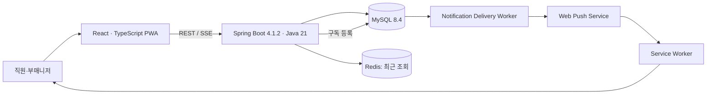

# jashop

> **현장 경험에서 출발한 다중 매장 직원 협업 플랫폼**  
> 설계 기준: 2026-11-05 · 상태: **설계 완료 / 초기 개발 진행 중** · 백엔드 중심 개인 프로젝트

여러 상품 매장의 **근무 일정·출퇴근**, **상품 위치·마지막 수동 재고 확인**, **창고 확인 요청**, **매장 간 인력 지원**, **업무 알림**을 하나로 연결하는 모바일 중심 서비스입니다.

실제 롯데 자이언츠 상품 매장에서 부매니저로 근무하며 겪었던 문제에서 출발했습니다. 다섯 개 매장을 운영하면서 POS 수량과 실제 수량이 다른 경우가 있었고, 창고에 직접 다녀오는 데 한 번에 약 10분이 걸리기도 했습니다. 현재 누가 어느 매장에서 근무하는지, 어떤 직원이 확인 업무를 맡았는지 빠르게 파악하기도 어려웠습니다.

jashop는 **실시간 POS 재고 시스템이 아닙니다.** 마지막으로 직원이 직접 확인한 수량·위치·시각을 공유하고, 필요한 확인 업무를 책임 있게 배분하는 **업무 협업 플랫폼**입니다.

## 해결하려는 문제

| 현장 문제 | jashop의 해결 방식 |
|---|---|
| 상품이 여러 매장·공용 창고에 흩어져 있음 | 매장 내부 창고와 공용 `외부창고`, `143`를 구분해 위치별 마지막 확인값 조회 |
| 상품 수량을 확인하려면 창고로 직접 이동해야 함 | 현장 직원에게 확인 요청을 보내고 한 명이 수락·완료하도록 업무 처리 |
| 같은 요청을 여러 직원이 중복 처리할 수 있음 | MySQL **조건부 UPDATE**로 요청 수락을 원자적으로 확정 |
| 어느 매장에 직원이 얼마나 있는지 즉시 파악하기 어려움 | 출퇴근과 지원 이동 상태를 합성해 현재 근무 위치 계산 |
| 경기일 퇴근 시각이 매일 다름 | 선택적 예정 퇴근 시각, 당일 퇴근 안내, 실제 체크아웃, 30분 단위 운영 기록을 분리 |
| 업무 알림을 놓칠 수 있음 | 알림함, SSE, PWA Web Push 및 DB 기반 전송 재시도 |

## 주요 기능

**계정·매장** — 직원 회원가입 후 총괄 매니저 승인. `STAFF`, `ASSISTANT_MANAGER`, `MANAGER` 역할과 매장 범위별 인가. 사용자의 기본 소속 매장과 실제 현재 근무 매장은 별개입니다.

**근무 관리** — 경기일에는 출근 시각만, 비경기일에는 09:00~19:00과 같이 출퇴근 예정 시각을 등록할 수 있습니다. 실제 체크인·체크아웃 원본을 보존하며, 부매니저가 지정하는 30분 단위 운영 기록을 별도로 관리합니다. 퇴근 안내는 직원별로 전송·확인합니다.

**상품·재고 확인** — 공통 상품/옵션(SKU), 내부/공용 창고, 위치별 마지막 확인 수량과 확인 이력. `null`(미확인)과 `0`(확인 결과 없음)을 구분하고 공용 창고 재고를 매장별로 복제하거나 중복 합산하지 않습니다.

**업무 요청** — 재고 확인 요청 생성 → 담당 매장 직원에게 알림 → 단 한 명 수락 → 실제 확인 → 이력·최신 확인값·완료 상태를 한 트랜잭션에 기록합니다.

**인력 지원** — 지원 요청 → 대상 매장 승인 및 직원 배정 → 출발·도착 → 지원 종료 → 원래 매장 복귀. 이동 중 직원은 어느 매장의 현재 근무 인원으로도 계산하지 않습니다.

**알림·PWA** — 사용자별 알림함, 브라우저 Web Push 구독, 서버발 이벤트(SSE), MySQL 전송 작업의 실패·재시도. Redis에는 직원별 최근 조회 **상품 옵션 10개**만 저장합니다.

## 역할별 권한

| 역할 | 주요 권한 |
|---|---|
| `STAFF` | 본인 출퇴근, 상품·위치 조회, 재고 확인 요청·수락·완료, 본인 지원 이동 확인, 알림 확인 |
| `ASSISTANT_MANAGER` | 직원 기능 + **담당 매장** 출퇴근 승인·퇴근 안내·인력 지원 요청/응답·배정 |
| `MANAGER` | 계정 승인·권한 배정, 전체 매장 및 공통 상품 마스터 관리, 근무 일정 생성/수정, 전체 운영 조회 |

> 매니저 권한이 모든 업무 명령을 아무 검증 없이 우회하는 권한이라는 뜻은 아닙니다. 도메인별 권한·현재 근무 상태·매장 범위는 서버가 검증합니다.

## 시스템 구조(목표 아키텍처)



**현재 소스에 구현 완료된 구조를 나타내는 다이어그램이 아니라, 설계된 목표 구조입니다.** 실제 구현·배포 완료 시 해당 상태를 업데이트합니다.

## 기술 스택

| 영역 | 선택 | 이유 |
|---|---|---|
| Backend | **Java 21, Spring Boot 4.1.2, Gradle** | Spring MVC·JPA·Security 기반 서버 개발 |
| Database | **MySQL 8.4** | 관계·제약·트랜잭션·동시성 제어 |
| Cache/auxiliary | **Redis** | 최근 조회 옵션 LIST, TTL, 검색 장애 격리 |
| Frontend | **React, TypeScript, Vite, PWA** | 모바일 우선 UX, 설치형 웹, Web Push |
| Authentication | **Spring Security + JWT + AuthSession** | 접근 토큰 검증 및 Refresh 회전/폐기 |
| Notification | **SSE + Web Push/VAPID + MySQL Delivery** | 온라인/백그라운드 알림과 재시도 분리 |
| Infra | **Docker Compose**, AWS(추후) | 로컬 재현성과 배포 확장 |
| Test | **JUnit, Spring Boot Test, Testcontainers(MySQL)** | 실제 DB 동시성 및 제약 검증 |

> Kafka, Elasticsearch, POS 연동, AI 음성 검색은 초기 MVP에서 제외합니다. 필요성이 검증되면 별도 의사결정 후 추가합니다.

## 저장소 구조

```text
jashop/
├── README.md
├── docs/
│   ├── 01-requirements.md
│   ├── 02-domain-model.md
│   ├── 03-erd.md
│   ├── 04-api-spec.md
│   ├── 05-architecture.md
│   ├── 06-decisions.md
│   └── 07-development-plan.md
├── jashop-backend/        # 생성된 Spring Boot 프로젝트
│   ├── build.gradle
│   ├── gradlew
│   └── src/
└── jashop-frontend/       # 생성된 React/Vite 프로젝트
```

로컬 인프라는 루트 `compose.yml`, 백엔드 연결은 `application.yaml`에 구성되어 있습니다.
Flyway V1은 `stores`, V2는 `users`, V3은 초기 관리자 생성 보호용 `manager_bootstrap`을 생성하며, 이후 DDL은 기능별로 추가합니다.
기존 문서에 적힌 `backend/`, `frontend/` 대신 **현재 저장소의 실제 폴더명**을 기준으로 합니다.

## 로컬 실행

```bash
# 저장소 루트
# Compose에 필요한 MYSQL_*/REDIS_PORT 환경변수를 먼저 설정
docker compose up -d

# 백엔드
cd jashop-backend
./gradlew --version
./gradlew test
./gradlew bootRun

# 다른 터미널에서 프론트엔드
cd jashop-frontend
npm ci
npm run dev
```

- MySQL·Redis 연결 URL과 비밀번호는 개발용 환경변수 또는 Git에 포함하지 않는 `.env`로 주입합니다.
- 현재 `application.yaml`은 MySQL `localhost:3308/jashop`, `${DB_USERNAME:jashop}`, `${DB_PASSWORD}`를 사용합니다. Compose 포트/계정과 일치해야 합니다.
- Compose가 읽는 `.env`는 Gradle/Spring에 자동 전달되지 않습니다. `bootRun` 실행 환경에도 DB 계정과 `DB_PASSWORD`를 설정해야 합니다.
- 프로젝트 이름 변경은 기존 MySQL 스키마·계정·Docker 컨테이너·볼륨을 자동으로 변경하지 않습니다. 루트 폴더명 변경으로 Compose 프로젝트명과 기본 볼륨명도 달라집니다. 기존 데이터를 사용할 때는 기존 볼륨과 DB 연결 설정을 명시적으로 맞춘 뒤 실행하며, 볼륨을 삭제해 초기화하지 않습니다. 새 `jashop` 스키마·계정으로 데이터를 이전하는 작업은 별도로 수행합니다.
- `./gradlew`는 **`jashop-backend/`** 아래에서 실행합니다.
- 전체 테스트에는 Docker가 필요합니다. Testcontainers가 기존 Compose DB/볼륨과 분리된 MySQL 8.4를 생성하며, Docker가 없으면 통합 테스트는 실패합니다(자동 스킵 없음).
- 2026-11-07 `./gradlew test`로 **29건 통과**: 공통 20건 + 실제 MySQL Store 영속성/마이그레이션 9건. 기존 공통 테스트는 계속 외부 DB와 분리됩니다.
- 이름 변경 전 로컬 MySQL 8.4.11의 빈 스키마에 V1 적용 후, 비웹 모드 기동을 두 번 실행해 최초 적용·재실행·JPA `validate`를 확인했습니다. HTTP API, Redis 기능, User 도메인은 이 검증에 포함되지 않습니다.

## 초기 MANAGER 생성

회원가입 API로 총괄 권한을 취득할 수 없다. 최초 운영자만 별도의 비웹 부트스트랩으로 생성한다.
기존 MANAGER가 있거나 생성 완료 기록이 있으면 재실행을 거부하며 기존 계정의 승격·비밀번호 재설정은 하지 않는다.

1. 대상 DB와 DB_USERNAME/DB_PASSWORD를 확인한다. 이 명령은 대상 DB에 미적용 Flyway 마이그레이션(V3 포함)을 적용한다.
2. `JASHOP_BOOTSTRAP_NAME`, `JASHOP_BOOTSTRAP_EMAIL`, `JASHOP_BOOTSTRAP_PASSWORD`를 실행 환경에 주입한다. 비밀번호는 회원가입과 동일하게 8~72자/UTF-8 최대 72바이트다. 비밀 관리 도구나 터미널의 숨김 입력을 사용하고 명령행 인자·소스·공유 로그에 비밀번호를 기록하지 않는다.
3. 백엔드 디렉터리에서 다음을 실행한다. 부트스트랩은 기본 비활성이며 비웹 모드를 명시해야 한다.

```bash
JASHOP_BOOTSTRAP_ENABLED=true ./gradlew --no-daemon bootRun --args='--spring.main.web-application-type=none --spring.data.redis.repositories.enabled=false'
```

성공 시 `ACTIVE/MANAGER` 계정과 생성 완료 기록을 같은 트랜잭션으로 저장한다. 기본 소속 매장과 승인자/승인 시각은 없고 완료 기록의 user_id/completed_at이 운영자 생성 근거다. 완료 기록을 지우거나 기존 계정을 자동 변경하지 않는다. 실행 후 부트스트랩 환경변수, 특히 비밀번호를 실행 환경에서 제거한다. 웹 서버는 일반 실행 환경으로 별도 기동한다.

현재 로그인/JWT는 미구현이므로 생성된 관리자 계정으로 웹 로그인을 할 수는 없다. 이번 구현에서는 기존 Compose DB에 마이그레이션을 적용하거나 실제 관리자 계정을 생성하지 않았다.

## 문서

| 문서 | 내용 |
|---|---|
| [01. 요구사항](docs/01-requirements.md) | 실제 업무 문제, 역할, 기능·비기능 요구사항, 시나리오, 인수 조건 |
| [02. 도메인 모델](docs/02-domain-model.md) | 17개 엔티티, 상태 전이, 현재 근무 매장 계산, 핵심 불변 조건 |
| [03. ERD](docs/03-erd.md) | 전체 관계도, 컬럼 사전, FK·UNIQUE·INDEX 및 마이그레이션 주의점 |
| [04. API 명세](docs/04-api-spec.md) | `/api/v1` 엔드포인트, 권한, DTO, 주요 트랜잭션·오류·동시성 |
| [05. 아키텍처](docs/05-architecture.md) | 의존성, 로컬 개발, 패키지 구조, 인증, 알림·캐시·배포 전략 |
| [06. 결정 기록](docs/06-decisions.md) | 확정 정책·구현 제안·미결 사항, 대안, 변경 사유 |
| [07. 개발 계획](docs/07-development-plan.md) | 구현 단계, Codex 활용 원칙, 테스트 시나리오, 완료 기준 |

## 핵심 기술적 결정

1. **재고는 마지막 확인값** — POS 잔량을 실제 가용 수량으로 오인하지 않습니다.
2. **원본과 운영 기록 분리** — 실제 체크아웃 시각을 보존하고, 30분 단위 기록은 별도 필드로 둡니다.
3. **단일 요청의 원자적 수락** — `UPDATE … WHERE status = 'REQUESTED'`와 변경 행 수로 동시 수락을 제어합니다.
4. **서로 다른 요청 간 직원 중복 배정 방지** — User 행 잠금과 활성 배정 검사, 일관된 잠금 순서를 적용합니다.
5. **확인 완료의 원자성** — StockVerification, StockRecord, StockCheckRequest를 같은 MySQL 트랜잭션에서 변경합니다.
6. **업무 기록과 외부 푸시 호출 분리** — 알림/전송 작업을 DB에 저장한 뒤 Worker가 비동기로 발송합니다.

## 범위 및 진행 상태

- **완료:** 요구사항·핵심 정책 합의, 17개 테이블 논리 설계, API 설계, 백엔드·프론트엔드 프로젝트 생성. Phase 1 공통 패키지·오류 응답·UTC Clock·Flyway 경로/안전 설정(2026-11-07).
- **완료(Phase 2-0/2-1):** 기존 DB 사전 점검, Store V1 마이그레이션·엔티티·Repository, UTC DATETIME(6) 매핑, 실제 MySQL 통합 테스트. 로컬 V1 적용 후 `stores` 행은 0개이며 임의 매장 시드는 없습니다.
- **현재 소스:** 루트 `compose.yml` 및 `application.yaml` 연결 설정 존재. 공통 테스트는 외부 MySQL/Redis 없이 실행하도록 분리.
- **완료(Phase 2-2A):** User 엔티티·역할/상태 enum·Repository, V2 users 마이그레이션, 이메일 정규화 및 MySQL 제약 검증. 로컬 운영 DB에 V2를 적용한 것은 아닙니다.
- **완료(Phase 2-2B):** 공개 회원가입 API(`POST /api/v1/auth/signup`), DTO 검증, BCrypt 비밀번호 해시, 중복 이메일 409 처리. 가입자는 STAFF/PENDING/소속 없음으로 생성되며 토큰·세션은 발급하지 않습니다.
- **완료(Phase 2-2C):** 운영 전용 초기 MANAGER 일회성 생성, DB 잠금/완료 기록, 계정 상태·총괄·담당 매장 부매니저 인가 서비스.
- **진행 예정:** 관리자 승인·인증, Store API 및 인가 서비스 연결, 나머지 업무 DDL·API·통합 테스트, PWA 화면 및 Web Push 실기기 검증, CI/CD·AWS 배포.
- **MVP 제외:** POS 연동, 자동 재고 차감, 불량·유실, 급여 계산, 인력 자동 추천, AI 음성/자연어 검색.

각 기능의 **확정 정책과 구현 제안은 [결정 기록](docs/06-decisions.md)에서 구분**합니다. 코드와 문서가 달라지면 변경 이유와 테스트 결과를 함께 업데이트합니다.
