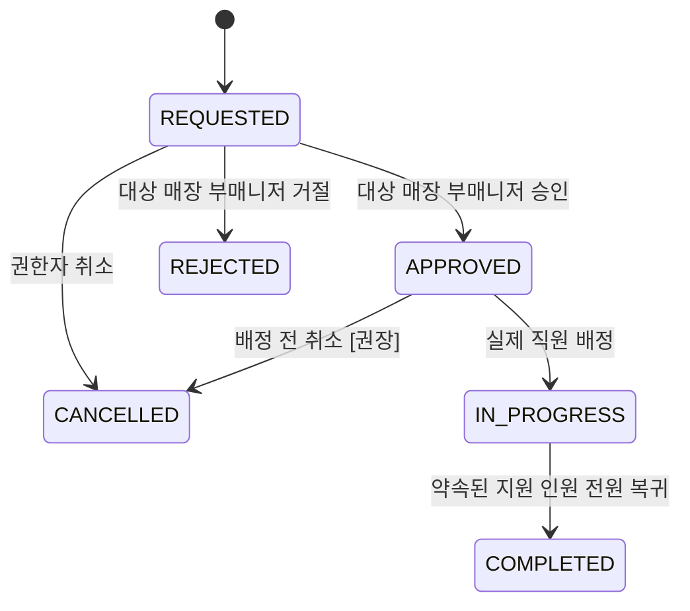
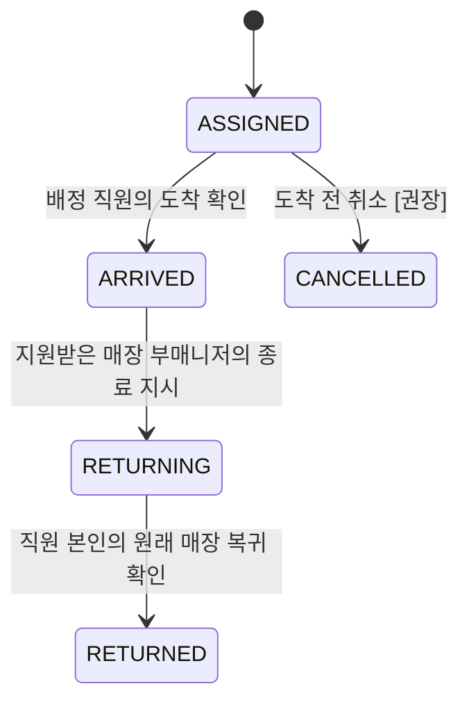
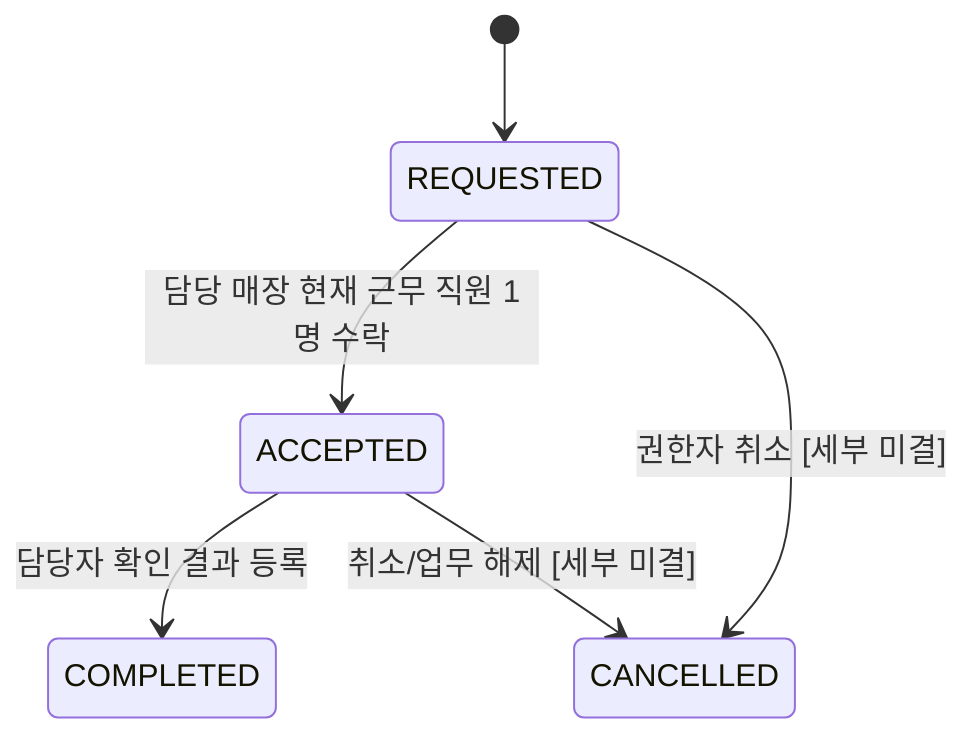

# 02. 도메인 모델 및 비즈니스 규칙

**기준:** 2026-11-05 · [확정] 비즈니스 요구 / [권장] 구현 전략 / [미결] 정책 결정을 구분한다. 모든 저장과 API는 `/api/v1` 및 MySQL을 업무 진실 원천(Source of Truth)으로 사용한다.

## 1. 도메인 경계와 핵심 책임

| 도메인 | 엔티티 | 책임 |
|---|---|---|
| Identity & Store | User, Store, AuthSession | 사용자 자격·매장 소속·Refresh 세션 수명주기 |
| Workforce | WorkSchedule, Attendance, CheckOutNotice | 예정 근무, 실제 출퇴근 원본, 퇴근 안내/운영 승인 |
| Support | SupportRequest, StaffAssignment | 매장 간 지원 요청·직원 이동 및 복귀 |
| Catalog & Stock | Product, ProductVariant, StorageLocation, StockRecord, StockCheckRequest, StockVerification | 상품 옵션·위치·마지막 수동 확인값·확인 업무·이력 |
| Notification | Notification, PushSubscription, NotificationDelivery | 알림함, 브라우저 구독, 비동기 전송·재시도 |

**총 17개 MySQL 테이블**이다. 공통 감사/Outbox/권한 매핑 테이블은 MVP의 확정된 17개 목록에 없다. 향후 필요하면 별도 ADR 후 추가한다.

## 2. 사용자·매장 모델

### User

- 식별: `id`, 유일한 `email`, 비밀번호 해시.
- 프로필: `name`, `role`, `status`, `homeStoreId`, 가입/승인/비활성화 시각.
- 역할 `STAFF`, `ASSISTANT_MANAGER`, `MANAGER`와 상태 `PENDING`, `ACTIVE`, `REJECTED`, `INACTIVE`는 **서로 독립적인 개념**이다.
- [확정] 가입 시 `PENDING`, 서버 지정 기본 역할 `STAFF`; 가입자가 직접 `role`이나 `homeStoreId`를 확정할 수 없다.
- [확정] 총괄 승인 시 직원/부매니저의 `homeStoreId` 필수. MANAGER는 선택적.
- [확정] 부매니저의 관리 대상 매장은 `homeStoreId`로 모델링한다. 한 매장에 여러 명이 배정될 수 있다.
- [권장] 권한의 최신성 확인은 매 요청 시 DB 또는 무효화 가능한 인증 상태 검사로 보완한다. 계정 비활성화 후 기존 Access JWT만 믿어 계속 사용하게 하면 안 된다.

### Store

- 공통 매장 마스터: `id`, `name`, `code`, `active`, 생성/수정 시각.
- 삭제보다는 `active=false`를 권장한다. 연관된 근무 일정·지원 요청·창고 위치 기록을 보존해야 한다.
- 과거에 지원한 매장, 현재 근무 매장, 기본 소속 매장은 다른 개념이므로 필드 혼용을 피한다.

### AuthSession

- Refresh Token 원문을 보관하지 않는다. `tokenHash`, `userId`, `familyId`(회전 계열), `expiresAt`, `revokedAt`, `replacedBy` 등의 필드로 발급·회전·폐기한다.
- Refresh 회전 시 이전 토큰을 폐기하고 새 토큰을 발급한다. 재사용 탐지 시 관련 세션을 무효화하는 정책은 [권장]이며 동시 Refresh 경쟁을 통합 테스트한다.
- 로그인하지 않은 PENDING 가입자의 승인 상태 안내는 최소한의 공개 API 응답으로 처리하고, 업무 API 사용을 허용하지 않는다.

## 3. 근무 관리: 세 시간은 서로 다르다

### WorkSchedule

```text
startAt = 매니저가 공지한 예정 출근 시각 (필수)
endAt   = 예정 퇴근 시각 (nullable)
```

- 경기일: 퇴근 시각이 정해지지 않을 수 있으므로 `endAt=null`.
- 비경기일: 실제 운영 사례는 09:00~19:00. 일률적으로 모든 비경기일을 하드코딩하지 않는다.
- 일정은 총괄 매니저가 생성·변경·취소한다. 취소는 `CANCELLED`로 보존한다.
- [권장] MVP에서 직원별 **한국 시간 기준 근무일에 활성 일정 하나**. `workDate`를 저장·인덱싱하거나 생성 컬럼으로 관리하면 날짜 기반 유일성을 DB에서 구현하기 쉽다. 종료 미정 일정을 시간 구간 검사만으로 보호할 수 없다.
- [권장] 동일 직원의 일정 생성·변경은 User 행 `PESSIMISTIC_WRITE` 등 동일한 직렬화 규칙을 사용한다. 활성 일정 유일성은 DB 제약으로 추가 방어한다.

### Attendance

**한 WorkSchedule당 최대 하나**. `UNIQUE(work_schedule_id)`.

| 필드 | 의미 | 작성자/시점 |
|---|---|---|
| `checkInAt` | 실제 체크인 서버 시각 | 본인 체크인 성공 시 서버 |
| `checkOutAt` | 실제 체크아웃 서버 시각 | 본인 체크아웃 성공 시 서버 |
| `recordedCheckOutAt` | 30분 단위로 지정된 운영상 퇴근 시각 | 기본 일정 매장 부매니저 승인 시 |
| `approvalStatus` | PENDING 또는 APPROVED | 초기 PENDING, 승인 후 APPROVED |
| `approvedBy`, `approvedAt` | 운영 기록 승인자 및 서버 시각 | 승인 성공 시 |

```text
WorkSchedule(SCHEDULED)
    └─ check-in -> Attendance(checkInAt=서버시각, checkOutAt=null, approval=PENDING)
          └─ check-out -> Attendance(checkOutAt=서버시각, approval=PENDING)
                └─ approve -> recordedCheckOutAt=관리자 입력, approval=APPROVED
```

- [확정] 실제 시각은 운영 기록/퇴근 안내로 덮어쓰지 않는다. 직원에게 퇴근 안내를 보냈어도 실제 체크아웃된 것은 아니다.
- [확정] 승인 시 기록 시각의 **서울 현지 분은 00/30, 초/소수 초 0**. 자동 내림·반올림·올림 금지.
- [확정] 출퇴근 원본을 인위적으로 조정하는 기능은 감사·권한 설계 전에는 만들지 않는다. 실제 근로시간과 급여를 허위로 계산하는 용도로 사용하지 않는다.
- [권장] 승인 후 재승인은 수정하지 않고 409, 동일 값의 단순 재시도는 이전 결과를 반환할 수 있다.
- [확정] 지원 직원의 출퇴근 승인은 원래 **WorkSchedule.storeId**를 관리하는 부매니저가 담당한다. 지원받은 매장의 부매니저가 아니다.
- [확정] ASSIGNED/ARRIVED/RETURNING 상태인 직원은 일반 체크아웃을 할 수 없다. RETURNED 또는 합법적 취소 후 가능.
- [권장] 여러 요청이 동시에 체크인/체크아웃/지원 배정을 시도해도 직원별 직렬화 규칙을 공유하도록 한다.

### CheckOutNotice

- 실제 현장 운영에 따라 부매니저가 선택된 직원들에게 퇴근 안내를 일괄 발송.
- `plannedCheckOutAt`은 예정 안내 시각이며 WorkSchedule.endAt을 수정하지 않는다.
- 같은 일정에 여러 번 재안내할 수 있어야 한다. **공지 행은 append-only**로 추가한다.
- `acknowledgedAt`은 직원 본인이 읽었음을 의미하며 체크아웃 완료/퇴근 기록 승인과 무관하다.
- 여러 직원에게 발송할 때는 대상 일정·관리 매장을 전부 검증한 뒤 한 트랜잭션으로 일괄 생성한다.

## 4. 인력 지원: 요청과 실제 이동은 별도 Aggregate

### SupportRequest

필드: `requestingStoreId`, `targetStoreId`, `requestedBy`, `requestedCount`, `reason`, `status`, `respondedBy`, `respondedAt`, `createdAt`.



- [확정] 지원을 **받는** 매장의 부매니저가 요청한다. 직원을 **보내는** 매장의 부매니저가 승인·거절·배정한다.
- `requestedCount>=1`, 서로 다른 두 매장, 대상 매장 활성 검증.
- 여러 부매니저가 동시에 승인/거절할 수 있다. `WHERE status='REQUESTED'` 조건부 UPDATE로 하나의 응답만 성공시킨다.
- [확정] 요청 인원보다 많이 배정할 수 없다. 활성 배정·이미 복귀한 지원 이력을 카운트할 때 정책을 명확히 한다.
- [미결] 요청 인원을 충족하지 못하는 부분 배정의 종료 방식. 임의로 `COMPLETED`라 표시하지 않는다.

### StaffAssignment

필드: `supportRequestId`, `userId`, `fromStoreId`, `toStoreId`, `assignedAt`, `arrivedAt`, `returnStartedAt`, `returnStartedBy`, `returnedAt`, `status`.



- `fromStoreId`는 직원을 보내는 매장, `toStoreId`는 지원받는 매장이다. 생성 시점에 스냅샷으로 기록한다.
- [확정] 배정 시점에 직원이 **보내는 매장에 실제 체크인한 WORKING 상태**여야 한다.
- [확정] 같은 직원이 서로 다른 요청에 중복 활성 배정될 수 없다.
- `UNIQUE(support_request_id,user_id)`는 **같은 요청 내 중복만** 막고, 서로 다른 두 요청의 중복 배정은 막지 못한다.
- [권장] 트랜잭션에서 지원 요청 행 및 대상 User 행을 잠그고 활성 배정 검사 + 생성. 여러 직원이면 **id 오름차순**으로 잠근다.
- [확정] 배정된 직원이 도착을 직접 확인, 받는 매장 부매니저가 지원 종료를 지시, 직원이 원 매장 복귀를 직접 확인한다.
- [확정] RETURNING 단계에서 원 매장 인원으로 먼저 계산하면 안 된다.

## 5. CurrentWorkStatus 도메인 서비스

```java
public record CurrentWorkStatus(
    Long userId,
    WorkLocationStatus status, // OFF_DUTY, WORKING, MOVING, RETURNING
    Long currentStoreId        // WORKING 상태에만 존재
) {}
```

| 근무 상태 | 활성 배정 상태 | 계산 결과 |
|---|---|---|
| 체크인 없음 또는 체크아웃 완료 | 없음 | OFF_DUTY / store=null |
| 체크인 중 | 없음, RETURNED, CANCELLED | WORKING / WorkSchedule.storeId |
| 체크인 중 | ASSIGNED | MOVING / store=null |
| 체크인 중 | ARRIVED | WORKING / StaffAssignment.toStoreId |
| 체크인 중 | RETURNING | RETURNING / store=null |

이 로직을 `AttendanceService`, `StockCheckRequestService`, `SupportService`, `NotificationRecipientResolver`에서 중복 작성하지 말고 `CurrentWorkStatusService`로 일원화한다. DB 상태의 시점 일관성이 필요한 명령에서는 같은 잠금·트랜잭션 안에서 조회한다. 화면용 GET의 즉시 계산과 업무 명령의 원자적 자격 검사는 책임이 다르다.

## 6. 상품 및 재고 확인 모델

### Product / ProductVariant

- Product는 매장과 무관한 공통 상품 마스터. 이름·분류·활성 여부 등을 관리한다.
- ProductVariant는 상품의 사이즈·색상 등 판매/확인 옵션을 나타낸다. SKU 고유 제약.
- 동일 상품 옵션은 여러 위치에 저장될 수 있고, 동일 위치에도 여러 옵션이 존재한다.
- [권장] 공통 마스터 변경은 총괄 MANAGER로 제한. 운영 직원은 조회·확인 업무만 수행.

### StorageLocation

- `INTERNAL`: 소유 매장 `storeId` 필수.
- `SHARED_EXTERNAL`: 공용 물리 창고 `storeId=null`.
- 확정 공용 상위 위치: **외부창고**, **143**.
- `parentId`를 이용한 구역/선반의 계층화는 선택적으로 지원한다. 부모·자식의 유형/매장 일치, 순환 금지.
- [권장] 실제 재고 확인 위치는 **말단(leaf) 위치**로 한정해 상위/하위 중복 집계를 방지한다.
- 위치가 비활성화되어도 과거 확인 이력은 보존한다.

### StockRecord — 마지막 확인 스냅샷

- 키: `(productVariantId, storageLocationId) UNIQUE`.
- `lastVerifiedQuantity NULL`이면 확인 기록이 없다는 의미, `0`이면 확인 후 0개.
- `lastVerifiedAt`, `lastVerifiedBy`(및 권장 `lastVerificationId`)를 함께 보존한다.
- StockRecord는 **POS 가용 수량이 아니며 판매 수량 자동 차감 대상도 아니다**.
- 직원이 StockRecord를 직접 PUT/PATCH하는 공개 API는 두지 않는다.

### StockCheckRequest



- 필드: `productVariantId`, `storageLocationId`, `requestedBy`, `requestingStoreId`, `responsibleStoreId`, `priority`, `status`, `assignedTo`, `requestedAt`, `acceptedAt`, `completedAt`, `escalatedAt`.
- `requestingStoreId`: 생성 당시 요청 직원의 **현재 근무 매장** 스냅샷.
- `responsibleStoreId`: INTERNAL이면 위치 소속 매장, SHARED_EXTERNAL이면 요청 직원의 현재 근무 매장.
- 알림 수신자는 담당 매장에 현재 체크인한 WORKING 직원. MOVING/RETURNING은 제외.
- 수락 시 자격은 **수락 순간**에 다시 검사한다. 화면에서 수락 버튼이 보였다는 사실만으로 허용하면 안 된다.
- 동시 수락 SQL: `UPDATE ... SET status='ACCEPTED', assigned_to=? WHERE id=? AND status='REQUESTED' AND assigned_to IS NULL`. 영향 행 수 1 → 성공, 0 → 충돌/상태 재검증.
- [미결] 이미 ACCEPTED인 담당자의 매장 이동·체크아웃과 요청 완료의 관계. 정책 확정 전 조용히 배정 권한을 바꾸지 않는다.

### StockVerification — 불변 확인 이력

- 확인 수량 `verifiedQuantity>=0`, 위치·옵션·확인자·서버 확인 시각·메모를 저장.
- `stockCheckRequestId`는 NULL 가능(수동/정기 확인의 미래 확장). 값이 있으면 **UNIQUE**: 요청당 완료 이력 최대 하나.
- 한 트랜잭션에서 요청 상태 검증 → 확인 이력 INSERT → 마지막 확인값 UPSERT/UPDATE → 요청 완료 → 알림/전송 작업 INSERT를 수행한다.
- StockRecord 최초 생성 경쟁에는 UNIQUE 키와 DB의 삽입 충돌 처리를 사용한다. 이미 존재하는 행은 원자적 UPDATE 또는 버전/행 잠금으로 갱신.
- [권장] `verifiedAt`은 완료 요청을 서버가 정상 처리한 시각. 실제 창고 관찰 시각이 별개라면 `observedAt` 추가를 별도 결정. 마지막 확인값은 **서버가 확정한 순서**를 기준으로 삼는 MVP 한계가 있다.

## 7. 알림·푸시·전송 작업

### Notification

- 수신자 `recipientId`, `type`, `title`, `body`, `targetType`, `targetId`, `createdAt`, `readAt`.
- 한 사용자에게 수신된 알림은 알림함에 남는다. `readAt!=null`은 **읽음**이지 수락/완료가 아니다.
- [권장] `eventKey` UNIQUE로 업무 이벤트 재처리 시 사용자별 중복 알림 생성 억제.

### PushSubscription

- 사용자와 기기의 Web Push 구독 연결: endpoint, p256dh, auth, 활성 여부, 등록/마지막 사용 시각.
- 한 사용자가 여러 기기에 등록 가능. 사용자 간 endpoint 임의 이전 금지.
- endpoint·키는 민감 정보이므로 평문 로그·응답에 포함하지 않는다. DB 암호화/접근 제한은 운영 환경에서 검토한다.

### NotificationDelivery

- Notification × PushSubscription별 하나의 전송 작업. `UNIQUE(notification_id,subscription_id)`.
- 상태 `PENDING → PROCESSING → SENT`, 실패 시 `PENDING` 재예약 또는 최종 `FAILED`.
- `attemptCount`, `nextAttemptAt`, `lockedUntil`, [권장] `claimToken`으로 Worker 중복 실행/오래된 Worker의 상태 덮어쓰기 방지.
- 외부 푸시 서비스가 요청을 수락해도 **단말 도착·실제 표시·사용자 읽음을 뜻하지 않는다**.
- 네트워크 타임아웃 시 중복 푸시 가능성이 있으므로 `Notification.id`를 통한 표시 중복 완화가 필요하다.
- [확정] 비즈니스 변경과 알림/전송 작업 저장은 MySQL 안에서 원자적으로 처리한다. 커밋 뒤 별도 Worker가 외부 푸시 서비스 호출. 외부 서비스 실패로 이미 커밋된 업무를 롤백하지 않는다.
- [미결] 장기 보존/정리, 미수락 에스컬레이션 임계시간, 푸시 중복 표시 정책의 최종값.

## 8. 트랜잭션·잠금 매트릭스

| 명령 | 잠글 대상 또는 원자 조건 | 불변 조건 |
|---|---|---|
| 일정 등록/수정 | 같은 직원 User 잠금 + 근무일 유일성 | 직원별 같은 근무일 활성 일정 1개 |
| 체크인/체크아웃 | 직원 User 잠금 + 해당 Attendance 상태 검사 | 직원당 활성 출근 최대 1개, 지원 중 체크아웃 불가 |
| 지원 요청 응답 | `UPDATE ... WHERE status='REQUESTED'` | 승인/거절 둘 중 하나만 성공 |
| 직원 다중 배정 | SupportRequest 잠금 → User ID 오름차순 잠금 → 활성 배정 검사 | 요청 정원과 직원 중복 활성 배정 차단 |
| 도착/복귀 | User + StaffAssignment 상태 검증 후 전이 | 실제 근무 위치 계산 일관성 |
| 재고 요청 수락 | User 근무 자격 검사 + StockCheckRequest 조건부 UPDATE | 담당 직원 하나만 수락 |
| 재고 확인 완료 | 요청 상태 잠금 → 이력 UNIQUE → Record 단일 최신값 갱신 | 이력/최신값/완료/알림 기록 원자성 |
| 푸시 발송 | 짧은 DB 트랜잭션에서 Delivery 선점 → 잠금 해제 → 외부 호출 | 다중 Worker 중복 선점 억제, 장애 후 복구 |

**잠금 순서의 일관성:** 요청에서 사용하는 User와 SupportRequest 잠금 순서는 API 전체에서 통일해야 한다. 특히 체크아웃, 지원 배정, 재고 수락 등 **현재 근무 자격이 변하는 명령** 사이의 경쟁을 통합 테스트한다. 비관적 잠금이 데드락을 완전히 제거하는 것은 아니다.

## 9. 도메인 이벤트와 알림 수신자

| 이벤트 | 수신자 | 발송 기준 |
|---|---|---|
| STOCK_CHECK_REQUESTED | responsibleStoreId에 현재 WORKING 직원 | 요청 생성 당시 수신자 선택, 실제 푸시 직전 유효성 검증 |
| STOCK_CHECK_ACCEPTED / COMPLETED | 요청자 | 요청/완료 이벤트별 개별 알림 |
| STOCK_CHECK_ESCALATED | 담당 매장 부매니저 | 설정 시간 미수락 + 중복 통지 방지 |
| SUPPORT_REQUESTED | targetStoreId 부매니저 | 지원 요청 생성 |
| SUPPORT_APPROVED / REJECTED | 요청자 | 승인/거절 |
| SUPPORT_ASSIGNED | 배정 직원 | 실제 지원 배정 |
| SUPPORT_ARRIVED | 지원받는 매장 부매니저 | 도착 확인 |
| SUPPORT_RETURN_REQUESTED | 배정 직원 | 지원 종료·복귀 지시 |
| SUPPORT_RETURNED | 보내는 매장 부매니저 | 복귀 확인 |
| CHECKOUT_NOTICE | 지정된 직원 | 현장 퇴근 안내 |
| ATTENDANCE_APPROVED | 해당 직원 | 승인 후 확인 |

SSE는 단순한 변경 이벤트를 보내며 실제 업무 상태는 REST 재조회한다. 앱이 종료된 후에는 Web Push만 지원 환경에서 작동하며 **전달·표시 보장은 하지 않는다**.

## 10. 테스트로 증명해야 하는 규칙

1. 경기일 `endAt=null`을 허용하고 한 근무일의 중복 일정 생성은 거부한다.
2. 체크인/체크아웃 실제 시각이 승인 시각/운영 기록으로 덮이지 않는다.
3. 동일 요청에 다수 직원이 수락하면 한 명만 변경 행 수 1을 얻는다.
4. 서로 다른 지원 요청에서 같은 직원을 동시에 배정해도 활성 배정은 하나다.
5. 지원 매장 도착·이동·복귀·체크아웃의 현재 근무 위치가 각 순간에 정확하다.
6. 공용 창고는 매장별 사본을 만들지 않는다. 0과 null을 구분한다.
7. 재고 완료 중 한 SQL이 실패하면 확인 이력·마지막 확인값·상태·알림이 모두 롤백된다.
8. Redis/푸시 장애와 MySQL 업무 처리의 장애 범위가 분리된다.
9. 다른 매장 부매니저가 승인·배정·퇴근 안내를 우회할 수 없다.

추가 구현·테스트 순서는 [07-development-plan.md](07-development-plan.md)를 참고한다.
