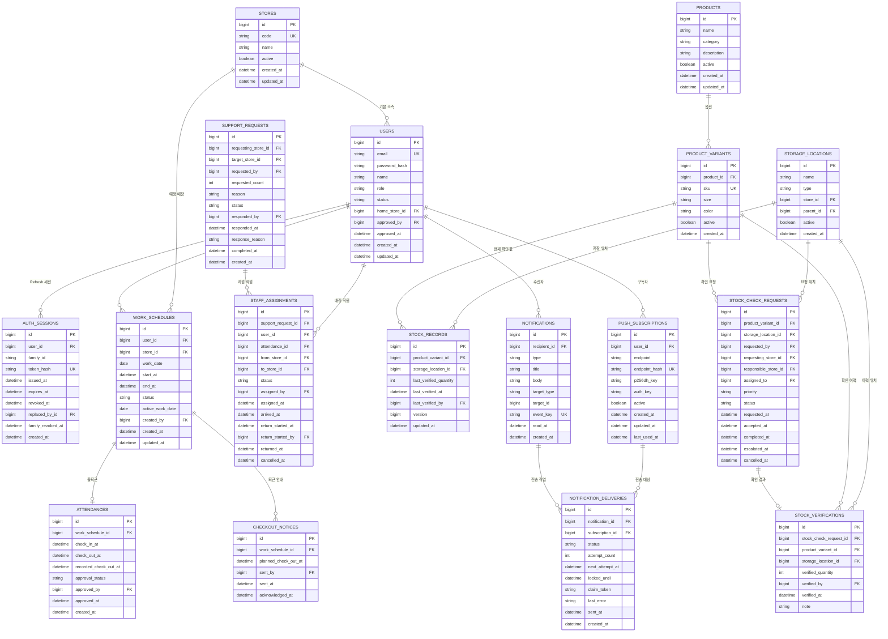

# 03. MySQL 논리 ERD · 컬럼 사전 · 제약/인덱스

- 기준일: 2026-11-05 · 목표 DB: MySQL 8.4 / InnoDB / utf8mb4
- **17개 테이블은 확정된 도메인 구성**이며, 이 문서의 상세 SQL 타입·추가 컬럼·인덱스는 구현 기준안이다.
- 실제 구현 전 Flyway DDL을 작성하고 MySQL Testcontainers로 검증한다. **이 문서 자체가 이미 실행된 마이그레이션은 아니다.**

**구현 상태(2026-11-11):** V1 stores, V2 users, V5 auth_sessions를 구현했다. 나머지 14개 업무 테이블은 미구현이다. V2는 별도 Testcontainers MySQL에서 검증하며 기존 로컬 DB에 자동 적용하지 않는다.
V4는 users의 선택적 거절 사유 컬럼(rejection_reason)을 추가한다. 기존 사용자 행은 유지한다.
V3 `manager_bootstrap` 운영 테이블을 추가했다(2026-11-10). `id TINYINT PK CHECK(id=1)`, `user_id BIGINT NULL FK users(id)`, `completed_at DATETIME(6) NULL`이며 사용자/완료 시각은 둘 다 NULL 또는 둘 다 NOT NULL이다. 초기 id=1 행을 생성하고 FOR UPDATE로 잠근 뒤 사용자 생성과 완료 기록을 한 트랜잭션으로 커밋한다. 완료 기록은 관리자 비활성화 후에도 보존한다.
목표 테이블은 업무 17개 + 운영 1개다. Flyway 이력 테이블은 이와 별개의 도구 관리 테이블이다.

## 1. 공통 규칙

- 모든 ID는 BIGINT(예: AUTO_INCREMENT)이며 서버 내부 Java `Long`으로 사용한다.
- MySQL `DATETIME(6)`은 **UTC로 저장/해석**한다. API는 UTC `Z` 또는 timezone offset을 갖는 ISO 8601을 사용한다.
- `work_date`는 서버가 `Asia/Seoul`에서 시작일을 계산한 DATE이며, 저장된 `start_at`의 UTC 날짜와 다를 수 있다.
- 개인정보/토큰 원문 로그 금지. 비밀번호는 안전한 단방향 해시, Refresh Token은 원문 미저장.
- 업무 이력은 hard delete 대신 상태/비활성화로 보존한다. FK에 CASCADE 삭제를 무분별하게 적용하지 않는다.
- MySQL CHECK는 같은 행의 값은 제한할 수 있으나 **다른 행/테이블을 아우르는 업무 불변식**은 표현하지 못한다. 서비스 트랜잭션과 잠금을 병행한다.
- `NOT NULL` 및 Unique 제약과 Spring Validation은 대체 관계가 아니라 보완 관계다.

## 2. 전체 관계도



> 관계도는 **주요 관계 중심**이다. `requested_by`, `created_by`, `approved_by` 등 추가 FK는 아래 컬럼 사전에 명시한다. Mermaid에서 실제 FK 복합/조건부 유일성 전부를 표현할 수 없어 인덱스 정의를 함께 참고해야 한다.

## 3. 17개 테이블 컬럼 사전

### 01. `stores` — 매장 마스터

구현: InnoDB / utf8mb4 / utf8mb4_0900_ai_ci, ID AUTO_INCREMENT,
`uk_stores_code` UNIQUE, 모든 컬럼 NOT NULL. 코드의 비교는 이 collation을 따른다.
Java의 생성/수정 시각은 `Instant`, JDBC는 UTC로 해석하는 TIMESTAMP 타입,
실제 MySQL 컬럼은 DATETIME(6)으로 매핑했다. 생성/변경 시각은 호출 측에서
`Instant.now(clock)`으로 제공한다. 임의 매장 시드·사용자 FK는 추가하지 않았다.
2026-11-10 Store API는 기존 스키마를 재사용한다. 생성은 uk_stores_code로 중복을 차단하고, 이름 변경/비활성화는 ID로 조회한 행에 PESSIMISTIC_WRITE 잠금을 건 서비스 트랜잭션에서 수행한다. 새 DDL이나 기존 V1~V3 변경은 없다.

| 컬럼 | MySQL 타입(권장) | 제약 | 의미 |
|---|---|---|---|
| `id` | `BIGINT` | PK NOT NULL | 매장 식별자 |
| `code` | `VARCHAR(40)` | NOT NULL UNIQUE | 고유 매장 코드 |
| `name` | `VARCHAR(120)` | NOT NULL | 매장 이름 |
| `active` | `BOOLEAN` | NOT NULL DEFAULT TRUE | 운영 여부 |
| `created_at` | `DATETIME(6)` | NOT NULL | 등록 시각 |
| `updated_at` | `DATETIME(6)` | NOT NULL | 수정 시각 |

### 02. `users` — 계정·권한·기본 소속

구현: `V2__create_users.sql`, InnoDB / utf8mb4 / utf8mb4_0900_ai_ci. 이메일 UNIQUE, 매장/승인자 FK(자동 연쇄 삭제 없음), 역할·상태 CHECK 및 ACTIVE 직원/부매니저의 소속 필수 CHECK를 적용했다. `(status, home_store_id, role)` 인덱스를 둔다. enum은 VARCHAR 문자열로 저장한다. 이메일 비교는 DB collation도 따르며 이메일 정규화와 동일한 의미의 이진 비교는 아니다. 승인자의 MANAGER 여부와 매장 활성 여부는 FK만으로 보장하지 않는다. UserReviewService가 요청자의 ACTIVE/MANAGER와 잠근 대상 User의 PENDING, 잠근 Store의 ACTIVE를 검사한다. V4는 기존 행을 유지하며 nullable rejection_reason VARCHAR(500)을 추가한다.

| 컬럼 | MySQL 타입(권장) | 제약 | 의미 |
|---|---|---|---|
| `id` | `BIGINT` | PK NOT NULL | 직원 ID |
| `email` | `VARCHAR(254)` | NOT NULL UNIQUE | 소문자/정규화한 이메일, 로그인 식별자 |
| `password_hash` | `VARCHAR(255)` | NOT NULL | 단방향 비밀번호 해시 |
| `name` | `VARCHAR(100)` | NOT NULL | 직원 이름 |
| `role` | `VARCHAR(32)` | NOT NULL | STAFF / ASSISTANT_MANAGER / MANAGER |
| `status` | `VARCHAR(24)` | NOT NULL | PENDING / ACTIVE / REJECTED / INACTIVE |
| `home_store_id` | `BIGINT` | NULL FK→stores.id | 총괄 승인 시 지정한 기본 소속 |
| `approved_by` | `BIGINT` | NULL FK→users.id | 가입 승인한 매니저 |
| `approved_at` | `DATETIME(6)` | NULL | 승인 시각 |
| `rejection_reason` | `VARCHAR(500)` | NULL | 가입 거절 사유(V4), 미입력은 null |
| `created_at` | `DATETIME(6)` | NOT NULL | 가입 시각 |
| `updated_at` | `DATETIME(6)` | NOT NULL | 수정 시각 |

### 03. `auth_sessions` — Refresh Token 회전/폐기

V5로 구현했다. 계열에서 가장 작은 ID가 불변 루트이며 계열 폐기 시각은 이 루트의 family_revoked_at을 기준으로 판단한다. 루트의 token revoked_at은 정상 회전에도 채워지므로 계열 폐기와 구분한다. family_id/token_hash는 ASCII 이진 비교 CHAR, token_hash UNIQUE, user/replacedBy FK, expiresAt > issuedAt CHECK 및 (family_id,id)/user_id 인덱스를 둔다. 루트·회전 이력은 보존하며 정리 기능은 미구현이다. 루트 PK를 잠가 모든 회전/폐기를 직렬화하고 Access는 루트의 사용자/만료/계열 폐기 상태를 조회한다.

| 컬럼 | MySQL 타입(권장) | 제약 | 의미 |
|---|---|---|---|
| `id` | `BIGINT` | PK NOT NULL | 세션 ID |
| `user_id` | `BIGINT` | NOT NULL FK→users.id | 세션 소유자 |
| `family_id` | `CHAR(36)` | NOT NULL | Refresh 회전 계열 UUID |
| `token_hash` | `CHAR(64)` | NOT NULL UNIQUE | Refresh 토큰의 안전한 해시 |
| `issued_at` | `DATETIME(6)` | NOT NULL | 발급 시각 |
| `expires_at` | `DATETIME(6)` | NOT NULL | 만료 시각 |
| `revoked_at` | `DATETIME(6)` | NULL | 폐기 시각 |
| `replaced_by_id` | `BIGINT` | NULL FK→auth_sessions.id | 다음 회전 세션 |
| `family_revoked_at` | `DATETIME(6)` | NULL | 루트 행에 기록하는 로그인 계열 폐기 시각 |
| `created_at` | `DATETIME(6)` | NOT NULL | 행 생성 시각 |

### 04. `work_schedules` — 예정 근무 일정

| 컬럼 | MySQL 타입(권장) | 제약 | 의미 |
|---|---|---|---|
| `id` | `BIGINT` | PK NOT NULL | 근무 일정 |
| `user_id` | `BIGINT` | NOT NULL FK→users.id | 대상 직원 |
| `store_id` | `BIGINT` | NOT NULL FK→stores.id | 예정 근무 매장 |
| `work_date` | `DATE` | NOT NULL | Asia/Seoul 기준 근무 시작일 |
| `start_at` | `DATETIME(6)` | NOT NULL | 예정 출근 시각 UTC |
| `end_at` | `DATETIME(6)` | NULL | 예정 퇴근 시각 UTC; 경기일 미정 가능 |
| `status` | `VARCHAR(24)` | NOT NULL | SCHEDULED / CANCELLED |
| `active_work_date` | `DATE` | GENERATED NULLABLE | SCHEDULED이면 work_date, 취소면 NULL |
| `created_by` | `BIGINT` | NOT NULL FK→users.id | 일정 등록 매니저 |
| `updated_by` | `BIGINT` | NOT NULL FK→users.id | 최종 변경 매니저 |
| `cancelled_by` | `BIGINT` | NULL FK→users.id | 취소 매니저 |
| `cancelled_at` | `DATETIME(6)` | NULL | 취소 시각 UTC |
| `created_at` | `DATETIME(6)` | NOT NULL | 등록 시각 |
| `updated_at` | `DATETIME(6)` | NOT NULL | 변경 시각 |

### 05. `attendances` — 실제 출퇴근과 운영 기록 승인

| 컬럼 | MySQL 타입(권장) | 제약 | 의미 |
|---|---|---|---|
| `id` | `BIGINT` | PK NOT NULL | 출퇴근 ID |
| `work_schedule_id` | `BIGINT` | NOT NULL UNIQUE FK→work_schedules.id | 일정당 하나 |
| `check_in_at` | `DATETIME(6)` | NOT NULL | 실제 체크인 서버 시각 UTC |
| `check_out_at` | `DATETIME(6)` | NULL | 실제 체크아웃 서버 시각 UTC |
| `recorded_check_out_at` | `DATETIME(6)` | NULL | 부매니저가 직접 지정한 30분 단위 운영 시각 |
| `approval_status` | `VARCHAR(24)` | NOT NULL | PENDING / APPROVED |
| `approved_by` | `BIGINT` | NULL FK→users.id | 기본 일정 매장 부매니저 |
| `approved_at` | `DATETIME(6)` | NULL | 승인 서버 시각 |
| `created_at` | `DATETIME(6)` | NOT NULL | 생성 시각 |

### 06. `checkout_notices` — 퇴근 안내 이력

| 컬럼 | MySQL 타입(권장) | 제약 | 의미 |
|---|---|---|---|
| `id` | `BIGINT` | PK NOT NULL | 안내 ID |
| `work_schedule_id` | `BIGINT` | NOT NULL FK→work_schedules.id | 대상 직원 일정 |
| `planned_check_out_at` | `DATETIME(6)` | NOT NULL | 안내한 예정 퇴근 시각 |
| `sent_by` | `BIGINT` | NOT NULL FK→users.id | 안내 발송 부매니저 |
| `sent_at` | `DATETIME(6)` | NOT NULL | 안내 발송 시각 |
| `acknowledged_at` | `DATETIME(6)` | NULL | 수신 직원의 확인 시각 |

### 07. `support_requests` — 매장 간 인력 지원 요청

| 컬럼 | MySQL 타입(권장) | 제약 | 의미 |
|---|---|---|---|
| `id` | `BIGINT` | PK NOT NULL | 지원 요청 ID |
| `requesting_store_id` | `BIGINT` | NOT NULL FK→stores.id | 지원받는 매장 |
| `target_store_id` | `BIGINT` | NOT NULL FK→stores.id | 직원을 보내는 매장 |
| `requested_by` | `BIGINT` | NOT NULL FK→users.id | 요청 부매니저 |
| `requested_count` | `INT` | NOT NULL | 요청 인원 ≥1 |
| `reason` | `VARCHAR(500)` | NOT NULL | 지원 사유 |
| `status` | `VARCHAR(24)` | NOT NULL | REQUESTED / APPROVED / IN_PROGRESS / COMPLETED / REJECTED / CANCELLED |
| `responded_by` | `BIGINT` | NULL FK→users.id | 대상 매장 응답자 |
| `responded_at` | `DATETIME(6)` | NULL | 응답 시각 |
| `response_reason` | `VARCHAR(500)` | NULL | 거절·취소 사유(권장) |
| `completed_at` | `DATETIME(6)` | NULL | 완료 시각 |
| `created_at` | `DATETIME(6)` | NOT NULL | 요청 생성 시각 |

### 08. `staff_assignments` — 지원 직원 배정 및 이동

| 컬럼 | MySQL 타입(권장) | 제약 | 의미 |
|---|---|---|---|
| `id` | `BIGINT` | PK NOT NULL | 배정 ID |
| `support_request_id` | `BIGINT` | NOT NULL FK→support_requests.id | 지원 요청 |
| `user_id` | `BIGINT` | NOT NULL FK→users.id | 배정 직원 |
| `attendance_id` | `BIGINT` | NULL FK→attendances.id | 배정 당시 근무(권장 스냅샷) |
| `from_store_id` | `BIGINT` | NOT NULL FK→stores.id | 직원을 보내는 매장 |
| `to_store_id` | `BIGINT` | NOT NULL FK→stores.id | 지원받는 매장 |
| `status` | `VARCHAR(24)` | NOT NULL | ASSIGNED / ARRIVED / RETURNING / RETURNED / CANCELLED |
| `assigned_by` | `BIGINT` | NULL FK→users.id | 배정한 부매니저 |
| `assigned_at` | `DATETIME(6)` | NOT NULL | 배정 시각 |
| `arrived_at` | `DATETIME(6)` | NULL | 도착 시각 |
| `return_started_at` | `DATETIME(6)` | NULL | 복귀 지시 시각 |
| `return_started_by` | `BIGINT` | NULL FK→users.id | 지원받는 매장 부매니저 |
| `returned_at` | `DATETIME(6)` | NULL | 원래 매장 복귀 확인 시각 |
| `cancelled_at` | `DATETIME(6)` | NULL | 도착 전 배정 취소 시각 |

### 09. `products` — 공통 상품 마스터

| 컬럼 | MySQL 타입(권장) | 제약 | 의미 |
|---|---|---|---|
| `id` | `BIGINT` | PK NOT NULL | 상품 ID |
| `name` | `VARCHAR(200)` | NOT NULL | 상품명 |
| `category` | `VARCHAR(100)` | NULL | 상품 분류 |
| `description` | `TEXT` | NULL | 설명(권장) |
| `active` | `BOOLEAN` | NOT NULL DEFAULT TRUE | 활성 여부 |
| `created_at` | `DATETIME(6)` | NOT NULL | 등록 시각 |
| `updated_at` | `DATETIME(6)` | NOT NULL | 변경 시각 |

### 10. `product_variants` — 사이즈·색상·SKU 옵션

| 컬럼 | MySQL 타입(권장) | 제약 | 의미 |
|---|---|---|---|
| `id` | `BIGINT` | PK NOT NULL | 상품 옵션 ID |
| `product_id` | `BIGINT` | NOT NULL FK→products.id | 상위 상품 |
| `sku` | `VARCHAR(100)` | NOT NULL UNIQUE | 고유 상품 옵션 코드 |
| `size` | `VARCHAR(50)` | NULL | 사이즈 |
| `color` | `VARCHAR(80)` | NULL | 색상 |
| `active` | `BOOLEAN` | NOT NULL DEFAULT TRUE | 활성 여부 |
| `created_at` | `DATETIME(6)` | NOT NULL | 등록 시각 |

### 11. `storage_locations` — 내부/공용 창고 및 세부 위치

| 컬럼 | MySQL 타입(권장) | 제약 | 의미 |
|---|---|---|---|
| `id` | `BIGINT` | PK NOT NULL | 위치 ID |
| `name` | `VARCHAR(120)` | NOT NULL | 위치명; 공용 외부창고/143 |
| `type` | `VARCHAR(32)` | NOT NULL | INTERNAL / SHARED_EXTERNAL |
| `store_id` | `BIGINT` | NULL FK→stores.id | INTERNAL 필수, 공용이면 NULL |
| `parent_id` | `BIGINT` | NULL FK→storage_locations.id | 선반·구역 부모 |
| `active` | `BOOLEAN` | NOT NULL DEFAULT TRUE | 활성 여부 |
| `created_at` | `DATETIME(6)` | NOT NULL | 등록 시각 |

### 12. `stock_records` — 옵션·위치별 마지막 수동 확인값

| 컬럼 | MySQL 타입(권장) | 제약 | 의미 |
|---|---|---|---|
| `id` | `BIGINT` | PK NOT NULL | 현재 확인값 ID |
| `product_variant_id` | `BIGINT` | NOT NULL FK→product_variants.id | 상품 옵션 |
| `storage_location_id` | `BIGINT` | NOT NULL FK→storage_locations.id | 확인 위치 |
| `last_verified_quantity` | `INT` | NULL | NULL 미확인, 0 확인 후 0개 |
| `last_verified_at` | `DATETIME(6)` | NULL | 마지막 서버 확인 완료 시각 |
| `last_verified_by` | `BIGINT` | NULL FK→users.id | 마지막 확인자 |
| `version` | `BIGINT` | NOT NULL DEFAULT 0 | 낙관적 충돌 검증용(권장) |
| `updated_at` | `DATETIME(6)` | NOT NULL | 수정 시각 |

### 13. `stock_check_requests` — 재고 확인 업무 요청

| 컬럼 | MySQL 타입(권장) | 제약 | 의미 |
|---|---|---|---|
| `id` | `BIGINT` | PK NOT NULL | 업무 요청 ID |
| `product_variant_id` | `BIGINT` | NOT NULL FK→product_variants.id | 확인 옵션 |
| `storage_location_id` | `BIGINT` | NOT NULL FK→storage_locations.id | 대상 물리 위치 |
| `requested_by` | `BIGINT` | NOT NULL FK→users.id | 요청자 |
| `requesting_store_id` | `BIGINT` | NOT NULL FK→stores.id | 요청 당시 근무 매장 스냅샷 |
| `responsible_store_id` | `BIGINT` | NOT NULL FK→stores.id | 담당 매장 스냅샷 |
| `assigned_to` | `BIGINT` | NULL FK→users.id | 수락 직원 |
| `priority` | `VARCHAR(24)` | NOT NULL | NORMAL / URGENT |
| `status` | `VARCHAR(24)` | NOT NULL | REQUESTED / ACCEPTED / COMPLETED / CANCELLED |
| `requested_at` | `DATETIME(6)` | NOT NULL | 요청 서버 시각 |
| `accepted_at` | `DATETIME(6)` | NULL | 수락 시각 |
| `completed_at` | `DATETIME(6)` | NULL | 완료 시각 |
| `escalated_at` | `DATETIME(6)` | NULL | 미수락 알림 시각 |
| `cancelled_at` | `DATETIME(6)` | NULL | 취소 시각 |

### 14. `stock_verifications` — 확인 결과의 불변 이력

| 컬럼 | MySQL 타입(권장) | 제약 | 의미 |
|---|---|---|---|
| `id` | `BIGINT` | PK NOT NULL | 확인 이력 ID |
| `stock_check_request_id` | `BIGINT` | NULL UNIQUE FK→stock_check_requests.id | 요청 완료 연동; NULL은 향후 수동 확인 허용 |
| `product_variant_id` | `BIGINT` | NOT NULL FK→product_variants.id | 옵션 스냅샷 |
| `storage_location_id` | `BIGINT` | NOT NULL FK→storage_locations.id | 위치 스냅샷 |
| `verified_quantity` | `INT` | NOT NULL | 확인 수량 ≥0 |
| `verified_by` | `BIGINT` | NOT NULL FK→users.id | 확인 직원 |
| `verified_at` | `DATETIME(6)` | NOT NULL | 서버 완료 시각 |
| `note` | `VARCHAR(500)` | NULL | 확인 메모 |

### 15. `notifications` — 개인별 알림함

| 컬럼 | MySQL 타입(권장) | 제약 | 의미 |
|---|---|---|---|
| `id` | `BIGINT` | PK NOT NULL | 알림 ID |
| `recipient_id` | `BIGINT` | NOT NULL FK→users.id | 수신자 |
| `type` | `VARCHAR(60)` | NOT NULL | 업무 알림 타입 |
| `title` | `VARCHAR(150)` | NOT NULL | 제목 |
| `body` | `VARCHAR(500)` | NOT NULL | 내용 |
| `target_type` | `VARCHAR(60)` | NULL | 화면 이동 대상 종류 |
| `target_id` | `BIGINT` | NULL | 대상 식별자 |
| `event_key` | `VARCHAR(180)` | NULL UNIQUE | 이벤트·수신자 중복 방지(권장) |
| `read_at` | `DATETIME(6)` | NULL | 읽음 시각 |
| `created_at` | `DATETIME(6)` | NOT NULL | 알림 생성 시각 |

### 16. `push_subscriptions` — 브라우저별 Web Push 구독

| 컬럼 | MySQL 타입(권장) | 제약 | 의미 |
|---|---|---|---|
| `id` | `BIGINT` | PK NOT NULL | 구독 ID |
| `user_id` | `BIGINT` | NOT NULL FK→users.id | 구독 소유자 |
| `endpoint` | `TEXT` | NOT NULL | 푸시 endpoint 원문; 민감 정보 |
| `endpoint_hash` | `BINARY(32)` | NOT NULL UNIQUE | endpoint SHA-256; 유일성 검색 |
| `p256dh_key` | `TEXT` | NOT NULL | 푸시 암호화 공개키 |
| `auth_key` | `TEXT` | NOT NULL | 푸시 인증 값 |
| `active` | `BOOLEAN` | NOT NULL DEFAULT TRUE | 구독 활성 여부 |
| `created_at` | `DATETIME(6)` | NOT NULL | 등록 시각 |
| `updated_at` | `DATETIME(6)` | NOT NULL | 갱신 시각 |
| `last_used_at` | `DATETIME(6)` | NULL | 마지막 시도 시각 |

### 17. `notification_deliveries` — 구독별 푸시 전송 작업

| 컬럼 | MySQL 타입(권장) | 제약 | 의미 |
|---|---|---|---|
| `id` | `BIGINT` | PK NOT NULL | 전송 작업 ID |
| `notification_id` | `BIGINT` | NOT NULL FK→notifications.id | 알림함 항목 |
| `subscription_id` | `BIGINT` | NOT NULL FK→push_subscriptions.id | 브라우저 구독 |
| `status` | `VARCHAR(24)` | NOT NULL | PENDING / PROCESSING / SENT / FAILED |
| `attempt_count` | `INT` | NOT NULL DEFAULT 0 | 시도 횟수 |
| `next_attempt_at` | `DATETIME(6)` | NULL | 다음 처리 가능 시각 |
| `locked_until` | `DATETIME(6)` | NULL | Worker lease 만료 시각 |
| `claim_token` | `CHAR(36)` | NULL | Worker 선점 식별 토큰(권장) |
| `last_error` | `VARCHAR(500)` | NULL | 민감값 없는 마지막 오류 |
| `sent_at` | `DATETIME(6)` | NULL | 푸시 서버 수락 시각 |
| `created_at` | `DATETIME(6)` | NOT NULL | 전송 작업 생성 시각 |

## 4. 핵심 UNIQUE 제약과 이유

| 제약 | 예시/목적 | 동시성 한계 |
|---|---|---|
| `users(email)` | 중복 회원가입 차단 | 이메일 정규화·대소문자 정책 필요 |
| `stores(code)` | 같은 매장 코드 중복 방지 | - |
| `auth_sessions(token_hash)` | 동일 Refresh 재사용/세션 식별 | 해시 충돌 가능성은 이론상 별도 고려 |
| `work_schedules(user_id,active_work_date)` | 같은 직원/날짜의 활성 일정 하나 | 생성 컬럼과 SCHEDULED 규칙이 실제 DDL에 있어야 함 |
| `attendances(work_schedule_id)` | 일정 하나당 Attendance 하나 | 서로 다른 일정의 동시 활성 출근은 User 잠금 등 필요 |
| `staff_assignments(support_request_id,user_id)` | 같은 지원 요청 안에서 중복 배정 차단 | **다른 요청 사이 중복 활성 배정은 못 막음** |
| `product_variants(sku)` | 상품 옵션 고유 SKU | 정규화된 SKU 비교 필요 |
| `stock_records(product_variant_id,storage_location_id)` | 한 옵션/물리 위치의 최신 확인값 하나 | 최초 INSERT 경쟁은 충돌 처리 |
| `stock_verifications(stock_check_request_id)` | 요청당 확인 완료 이력 최대 하나 | `NULL` 여러 행 허용으로 향후 수동 확인 가능 |
| `notifications(event_key)` | 같은 이벤트·수신자 중복 알림 완화 [권장] | 동일 업무의 별도 이벤트마다 다른 키 필요 |
| `push_subscriptions(endpoint_hash)` | URL TEXT 인덱스 한계 회피 [권장] | 해시 일치 시 endpoint 원문도 대조 |
| `notification_deliveries(notification_id,subscription_id)` | 알림-브라우저 조합별 전송 작업 하나 | 네트워크 중복 전송 자체는 방지하지 못함 |

### 활성 근무 일정 유일성 예시

MySQL UNIQUE는 여러 NULL을 허용한다. `CANCELLED` 일정을 보존하면서 활성 일정만 유일하게 만들 수 있다.

```sql
-- work_date는 Asia/Seoul로 계산해 명시 저장한다.
ALTER TABLE work_schedules
  ADD COLUMN active_work_date DATE
    GENERATED ALWAYS AS (
      CASE WHEN status = 'SCHEDULED' THEN work_date ELSE NULL END
    ) STORED;
CREATE UNIQUE INDEX uk_schedule_user_active_date
  ON work_schedules(user_id, active_work_date);
```

위 SQL은 **마이그레이션 예시**다. 컬럼 사전에서 `active_work_date`를 처음부터 포함한다면 ALTER가 아니라 CREATE TABLE 안에 정의하고 중복 생성하지 않는다.

## 5. 핵심 INDEX 권장안

| 테이블 | 인덱스 | 실제 조회 패턴/근거 |
|---|---|---|
| `users` | `(status,home_store_id,role)` | 매장별 활성 직원/부매니저 |
| `auth_sessions` | `(user_id,revoked_at,expires_at)` | 사용자별 세션 폐기/조회 |
| `work_schedules` | `(store_id,start_at,id)` | 매장 일정 날짜 조회 |
| `work_schedules` | `UNIQUE (user_id,active_work_date)` | 중복 활성 일정 강제 |
| `attendances` | `UNIQUE (work_schedule_id)` | 일정별 출퇴근 하나 |
| `checkout_notices` | `(work_schedule_id,sent_at,id)` | 직원 일정별 퇴근 안내 이력 |
| `support_requests` | `(target_store_id,status,created_at,id)` | 받은 지원 요청 목록 |
| `support_requests` | `(requesting_store_id,status,created_at,id)` | 보낸 지원 요청 목록 |
| `staff_assignments` | `(user_id,status,assigned_at)` | 직원 활성 지원 여부 |
| `staff_assignments` | `(support_request_id,status)` | 요청별 배정 인원/상태 |
| `product_variants` | `UNIQUE (sku)` | SKU 조회 |
| `product_variants` | `(product_id,active)` | 상품별 옵션 |
| `storage_locations` | `(type,store_id,active)` | 내부/공용 위치 조회 |
| `stock_records` | `UNIQUE (product_variant_id,storage_location_id)` | 마지막 확인값 |
| `stock_check_requests` | `(responsible_store_id,status,requested_at,id)` | 매장 미처리 요청 목록/에스컬레이션 |
| `stock_check_requests` | `(requested_by,requested_at,id)` | 내 요청 |
| `stock_verifications` | `(product_variant_id,storage_location_id,verified_at,id)` | 옵션·위치별 확인 이력 |
| `notifications` | `(recipient_id,created_at,id)` | 알림함 최신순 |
| `notifications` | `(recipient_id,read_at)` | 미읽음 집계 |
| `push_subscriptions` | `(user_id,active)` | 개인별 활성 구독 |
| `notification_deliveries` | `(status,next_attempt_at,id)` | Worker 대기 작업 선택 |
| `notification_deliveries` | `UNIQUE (notification_id,subscription_id)` | 전송 중복 작업 방지 |

- FK/UNIQUE는 MySQL에서 인덱스를 자동 생성할 수도 있다. 실제 DDL의 `SHOW INDEX`, `EXPLAIN ANALYZE`를 확인해 중복된 인덱스를 제거한다.
- 인덱스를 늘리면 조회는 빨라질 수 있지만 INSERT/UPDATE 비용과 저장 공간이 증가한다.
- 여러 조건을 사용하는 복합 인덱스는 일반적으로 선행 열(leftmost prefix)을 활용하는 조회에 적합하다.

## 6. 데이터 유효성·정합성 제약

1. `work_schedules.end_at IS NULL OR end_at > start_at`.
2. `users`: ACTIVE인 STAFF/ASSISTANT_MANAGER에 `home_store_id` 필수. PENDING은 NULL 허용.
3. `storage_locations`: INTERNAL이면 `store_id IS NOT NULL`; SHARED_EXTERNAL이면 `store_id IS NULL`. 부모 계층의 유형/매장 일치와 순환 검사는 서비스에서 수행.
4. `support_requests`: `requested_count > 0`, `requesting_store_id <> target_store_id`.
5. `stock_verifications.verified_quantity >= 0`; `stock_records.last_verified_quantity IS NULL OR >=0`.
6. `attendances`: checkOutAt이 존재하면 checkOutAt >= checkInAt. APPROVED이면 checkOutAt·recordedCheckOutAt·approvedBy·approvedAt 모두 존재. **30분 경계 검증은 Asia/Seoul 변환 후 서비스에서 수행**.
7. `stock_check_requests`: ACCEPTED라면 assignedTo/acceptedAt 필수, COMPLETED라면 completedAt 필수. UPDATE에서는 담당자·상태·근무 자격 검증을 함께 수행.
8. NotificationDelivery: `attempt_count >= 0`, 선점 토큰/만료는 PROCESSING에만 유효, 최종 SENT에는 sentAt 필수.
9. `StockRecord` 직접 수정 공개 API는 금지. 완료 명령에 의해 검증 이력과 같이 변경.
10. UNIQUE가 있어도 **여러 행을 합산하는 지원 정원** 및 **서로 다른 요청에 대한 직원 중복 활성 배정**은 행 잠금과 서비스 검증으로 처리.

## 7. 초기값/시드 데이터 정책

- 매장 코드는 실제 운영에 맞게 총괄이 등록한다. **매장 이름/개수에 의존하는 비즈니스 코드 하드코딩 금지**.
- 공용 위치 `외부창고`, `143`을 `SHARED_EXTERNAL`, `store_id=NULL`, `active=TRUE`로 생성한다. 물리적으로 동일한 창고를 매장별로 중복 INSERT하지 않는다.
- 초기 MANAGER 계정은 환경변수/관리자 부트스트랩을 통해 안전하게 생성한다. 일반 회원가입으로 MANAGER 부여 금지.
- 초기 제품/옵션은 운영자 등록 API 또는 마이그레이션 시드로 준비하되, 실제 수량을 임의로 확정해 저장하지 않는다.

## 8. Flyway 마이그레이션 순서(권장)

현재 V1은 `stores`만 생성한다. 아래 목록은 의존 순서이며 한 버전에 모두 만들라는 의미가 아니다.
이미 적용된 V1은 변경하지 않고, User 등 후속 테이블은 V2 이후에 추가한다.

1. `stores` → `users` → `auth_sessions` (users 자기 참조 승인 FK는 별도 ALTER 가능).
2. `work_schedules` → `attendances` → `checkout_notices`.
3. `support_requests` → `staff_assignments`.
4. `products` → `product_variants` → `storage_locations` → `stock_records` → `stock_check_requests` → `stock_verifications`.
5. `notifications` → `push_subscriptions` → `notification_deliveries`.
6. FK와 UNIQUE, 인덱스, CHECK, 초기 공용 창고/매장 마스터 데이터를 별도 버전에서 검증한다.

Flyway 적용 후에는 `spring.jpa.hibernate.ddl-auto=validate`를 사용한다. `create` 또는 `update`로 운영 스키마를 자동 변형하지 않는다.

## 9. 주요 테스트

- `work_schedules.end_at=null` 및 09:00~19:00 일정, 취소 이력과 활성 일정 유일성.
- 같은 직원/날짜를 두 트랜잭션이 동시에 등록할 때 정확히 하나만 성공.
- StockRecord의 `NULL`/0/양수 및 공용 창고의 단일 레코드.
- StockVerification에서 같은 요청 ID 2회 완료 시 UNIQUE 충돌, 원자적 롤백.
- 지원 요청 정원 초과 및 서로 다른 두 요청의 동일 직원 중복 활성 배정.
- Web Push endpoint 해시 중복 등록/다른 사용자 소유권 충돌.
- NotificationDelivery 작업자 선점/만료/재시도 동작.

실제 마이그레이션을 만들 때 이 문서를 기준으로 열 이름과 API DTO 간 명칭 일치 여부를 점검한다.


### Phase 4 구현 메모 (2026-11-12)

V6는 work_schedules와 체크인 변경 가드용 attendances를 생성한다. WorkSchedule API/엔티티를 구현했으며 Attendance API/엔티티는 후속 단계다. work_date는 서울 날짜, UTC start/end에 +9시간한 날짜의 일치와 end>start를 DB CHECK로 검증한다. SCHEDULED이면 취소 메타데이터는 null, CANCELLED이면 두 취소 필드가 필수다. active_work_date는 STORED 생성 열이며 UNIQUE(user_id,active_work_date)로 활성 중복만 제한한다. 일정당 출퇴근 기록은 하나다. 최초/최종/취소 메타데이터를 보관하며 전체 수정 스냅샷 이력은 이번에 추가하지 않는다.
