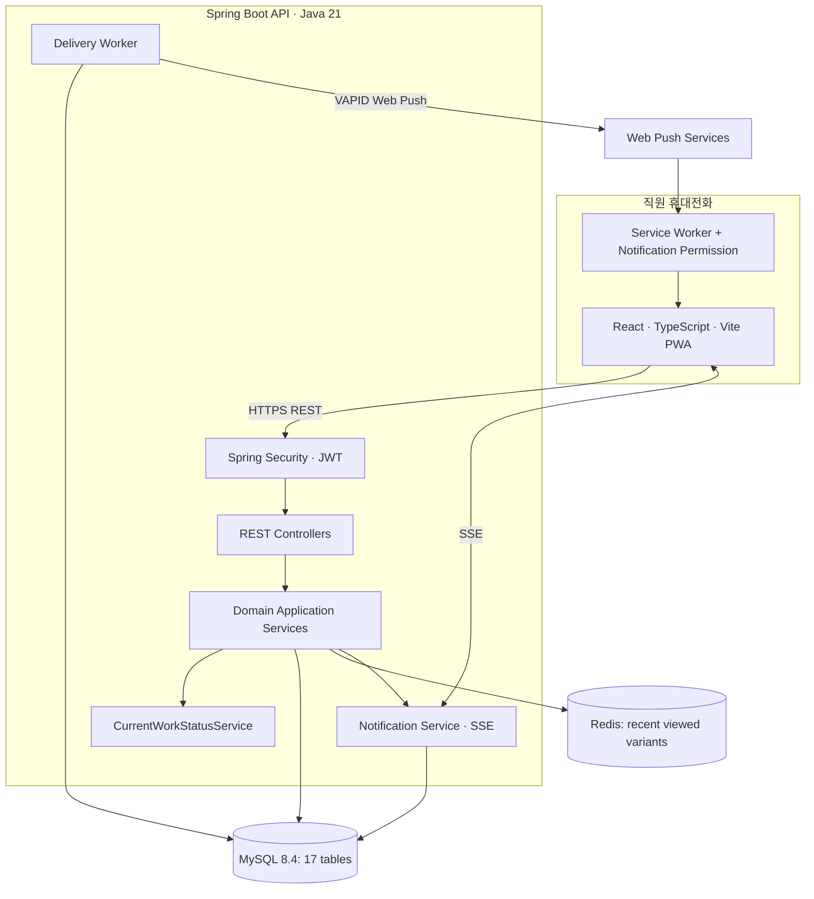
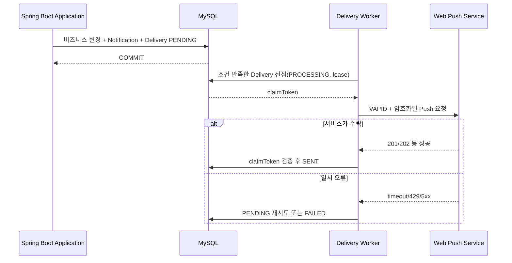

# 05. 기술 아키텍처 및 개발 환경

**기준일:** 2026-11-05 · 설계/구현 상태를 구별한다. **[현재]**는 사용자가 실제로 생성했다고 확인한 설정, **[권장]**은 아직 적용 여부를 확인하지 않은 제안이다.

## 1. 현 저장소와 기술 환경

```text
storeflow/
├── README.md
├── docs/
├── storeflow-backend/           # 실제 생성한 Spring Boot 프로젝트
│   ├── build.gradle
│   ├── settings.gradle
│   ├── gradlew
│   ├── gradle/wrapper/
│   └── src/main/java/com/storeflow/backend/
└── storeflow-frontend/          # 실제 생성한 React/Vite 프로젝트
```

**[현재] 사용자가 전달한 `build.gradle`**:

| 항목 | 확인 내용 |
|---|---|
| Group | `com.storeflow` |
| Spring Boot | `4.1.2` |
| Java Toolchain | `21` |
| Build | Gradle Groovy DSL, `io.spring.dependency-management` `1.1.7` |
| Spring | Actuator, Data JPA, Data Redis, Security, Validation, Web MVC |
| Driver | `com.mysql:mysql-connector-j` |
| Test | 분리된 Boot 4 Starter Test 모듈, JUnit Platform Launcher |

**공식 문서 검증:** Spring Boot 4.1.2는 Java 17 이상을 지원하고 Gradle 8.x의 경우 **8.14 이상**을 요구한다. Java 21은 적합하다. Wrapper의 실제 버전은 `storeflow-backend/gradle/wrapper/gradle-wrapper.properties`에서 확인해야 한다. 버전 변경은 Java/Gradle/플러그인 호환성을 재검증한 다음 진행한다.

공식 근거:
- Spring Boot 시스템 요구사항: https://docs.spring.io/spring-boot/system-requirements.html
- Spring Boot 4.1.2 Reference: https://docs.spring.io/spring-boot/reference/
- Spring Boot Build Systems: https://docs.spring.io/spring-boot/reference/using/build-systems.html

## 2. 목표 논리 아키텍처



**MySQL = 업무 상태·이력의 신뢰 원천**, Redis = 부가 최근 조회, SSE = 실행 중 UI 변경 안내, Web Push = 백그라운드 알림. 실시간 알림을 놓쳤다고 해서 업무 상태가 사라지지 않는다.

## 3. 패키지 구조 [권장]

Spring Boot는 **package-by-feature**를 기본으로 하고, 너무 이른 시기에 각 기능을 복잡한 멀티모듈로 쪼개지 않는다.

```text
storeflow-backend/src/main/java/com/storeflow/backend/
├── StoreflowBackendApplication.java
├── global/
│   ├── config/             # Clock, Jackson, CORS, OpenAPI, Redis
│   ├── security/           # SecurityFilterChain, JWT, 인증 principal
│   ├── error/              # ErrorCode, BusinessException, GlobalExceptionHandler
│   └── support/            # Pageable/시간/공통 검사 도구
├── auth/                   # signup, login, refresh, AuthSession
├── user/                   # 계정·승인·권한
├── store/                  # 매장
├── workforce/              # WorkSchedule, Attendance, CheckOutNotice
├── staffing/               # SupportRequest, StaffAssignment, CurrentWorkStatus
├── catalog/                # Product, ProductVariant
├── inventory/              # StorageLocation, StockRecord, StockCheckRequest,
│                            # StockVerification
└── notification/           # Notification, Subscription, Delivery, SSE
```

기능별 하위 구조 예시:

```text
inventory/
├── api/            # REST Controller, Request/Response DTO
├── application/    # 업무 유스케이스, @Transactional
├── domain/         # 엔티티, enum, 도메인 규칙
└── infrastructure/ # JPA Repository, Redis 등 영속성 접근
```

개인 프로젝트 MVP에서는 기능당 무조건 4계층을 만들 필요는 없다. 유지보수가 쉬운 크기부터 시작해 필요해질 때 분리한다. `@Transactional`은 API Controller가 아니라 **업무 유스케이스 서비스**에서 경계를 잡는다.

## 4. Spring Boot 의존성

### 4.1 기존 의존성은 유지

사용자가 만든 `build.gradle`의 다음 의존성은 StoreFlow에 적합하다.

```gradle
implementation 'org.springframework.boot:spring-boot-starter-actuator'
implementation 'org.springframework.boot:spring-boot-starter-data-jpa'
implementation 'org.springframework.boot:spring-boot-starter-data-redis'
implementation 'org.springframework.boot:spring-boot-starter-security'
implementation 'org.springframework.boot:spring-boot-starter-validation'
implementation 'org.springframework.boot:spring-boot-starter-webmvc'
runtimeOnly 'com.mysql:mysql-connector-j'
```

`spring-boot-starter-webmvc` 및 도메인별 `*-test` Starter 분리는 Spring Boot 4의 구성과 일치한다. 기존 Test Starter들을 확인 없이 모두 교체하지 않는다.

### 4.2 단계적으로 추가 [권장]

| 도입 시점 | 후보 | 이유 |
|---|---|---|
| 1단계 | `org.springframework.boot:spring-boot-starter-flyway` + `org.flywaydb:flyway-mysql` | MySQL 8.4 스키마 버전 관리 |
| Auth 구현 | `org.springframework.boot:spring-boot-starter-security-oauth2-resource-server` | JWT 서명·표준 검증 구성(구체 의존성 확인) |
| 통합 테스트 | Spring Boot Testcontainers 지원 + `org.testcontainers:mysql` + JUnit Jupiter 연동 | 진짜 MySQL 잠금·제약 검증 |
| API 완성 | Springdoc OpenAPI, Spring Boot 4 호환 버전 확인 | Swagger UI·계약 검증 |
| Web Push 단계 | Web Push/VAPID Java 라이브러리(호환 검증) | 브라우저 푸시 전송 |

Flyway 의존성은 공식 Spring Boot 데이터베이스 초기화 가이드에 근거한다: https://docs.spring.io/spring-boot/how-to/data-initialization.html . JWT 구현은 `spring-security-oauth2-resource-server`와 JOSE 지원이 필요하므로 실제 Starter/전이 의존성을 확인한다: https://docs.spring.io/spring-security/reference/servlet/oauth2/resource-server/jwt.html .

## 5. 로컬 개발 인프라 [권장]

**Spring Boot는 IntelliJ/Gradle로 직접 실행**, MySQL과 Redis는 Docker Compose로 분리한다. 기존 Mac의 3306 충돌을 피하도록 호스트 포트 3307을 예시로 사용한다. 보안상 컨테이너 포트는 `127.0.0.1`에만 바인딩한다.

저장소 루트의 `compose.yaml` **예시**:

```yaml
services:
  mysql:
    image: mysql:8.4
    environment:
      MYSQL_DATABASE: storeflow
      MYSQL_USER: storeflow
      MYSQL_PASSWORD: ${MYSQL_PASSWORD}
      MYSQL_ROOT_PASSWORD: ${MYSQL_ROOT_PASSWORD}
    ports:
      - "127.0.0.1:3307:3306"
    volumes:
      - mysql_data:/var/lib/mysql
    healthcheck:
      test: ["CMD-SHELL", "mysqladmin ping -h 127.0.0.1 -u root -p\"$$MYSQL_ROOT_PASSWORD\""]
      interval: 10s
      timeout: 5s
      retries: 10
  redis:
    image: redis:7-alpine
    ports:
      - "127.0.0.1:6379:6379"
    volumes:
      - redis_data:/data
volumes:
  mysql_data:
  redis_data:
```

`.env.example`에는 비밀값의 **이름과 설명만** 넣고 실제 `.env`는 Git 제외. 예시 compose를 그대로 사용하기 전에 `MYSQL_PASSWORD`, `MYSQL_ROOT_PASSWORD`를 로컬 환경에서 설정해야 한다. 컨테이너 healthcheck와 DB 실행 가능 상태는 별개의 단계이므로 애플리케이션 시작 시 초기 연결 실패가 발생하면 healthcheck와 로그를 먼저 확인한다.

`storeflow-backend/src/main/resources/application-local.yml` **예시**:

```yaml
spring:
  datasource:
    url: ${DB_URL:jdbc:mysql://localhost:3307/storeflow}
    username: ${DB_USERNAME:storeflow}
    password: ${DB_PASSWORD}
    driver-class-name: com.mysql.cj.jdbc.Driver
  jpa:
    open-in-view: false
    hibernate:
      ddl-auto: none     # Flyway 도입 전 연결 점검 단계
  data:
    redis:
      host: ${REDIS_HOST:localhost}
      port: ${REDIS_PORT:6379}
```

Flyway 마이그레이션이 완료된 후에는 `ddl-auto: validate`로 바꾸고 DDL을 JPA 자동 update에 의존하지 않는다. 실비밀번호를 `application*.yml`에 커밋하지 않는다. **DB 연결 오류** `Failed to configure a DataSource: 'url' attribute is not specified`는 MySQL Connector/J가 있더라도 URL 등 DataSource 설정이 누락됐을 때 발생할 수 있다.

### 5.1 실행 명령

```bash
# 저장소 루트
cp .env.example .env     # 예시 파일이 준비된 뒤 사용, 실제 비밀번호 설정
docker compose up -d
docker compose ps

# 백엔드만 이동해서 실행
cd storeflow-backend
./gradlew --version
./gradlew test
./gradlew bootRun --args='--spring.profiles.active=local'
```

Gradle Wrapper 버전은 `gradle-wrapper.properties`에서 실제 확인한다. `compose.yaml`이 프로젝트 루트에 있고 백엔드가 하위 폴더에 있으므로 `cd storeflow-backend` 상태에서 그냥 `docker compose up`을 실행하면 설정 파일을 찾지 못할 수 있다.

**선택 사항:** Spring Boot Docker Compose 자동 서비스 연결을 쓰는 경우에는 수동 DataSource 설정과 적용 우선순위를 확인해야 한다. 초기는 명시적 `application-local.yml` 연결이 학습에 더 직관적이다.

## 6. 인증·인가 전략

1. **Access JWT:** 짧은 유효기간, issuer/audience/signature/expiration 검증. Access Token은 가급적 브라우저 메모리에만 보관.
2. **Refresh:** MySQL AuthSession에서 해시로 관리, HttpOnly + Secure Cookie, rotate/revoke, 동시 회전·재사용 검출.
3. **계정 상태/권한:** 토큰 서명이 유효해도 사용자 ACTIVE 및 현재 역할/관리 매장을 재검증해야 한다. 관리자 비활성화가 즉시 반영되도록 구성.
4. **서버측 매장 인가:** `@AuthenticationPrincipal`과 DB 연관관계로 매장·직원 리소스를 검증한다. 클라이언트의 `storeId`만 신뢰하지 않는다.
5. **CORS/CSRF:** React 개발 서버 origin을 명시적으로 허용. Refresh 쿠키 요청은 CSRF 보호 및 `Origin` 검증을 적용. 일반 Access Bearer API도 신뢰 가능한 요청 출처를 검토.
6. **보안 로그:** Refresh/Access 원문, 해시·비밀번호·구독 키·endpoint, 직원의 불필요한 개인정보 출력 금지.

가입 대기 계정의 푸시 구독은 생성하지 않는다. 초기 MANAGER는 안전한 부트스트랩/운영자 설정으로만 생성한다.

## 7. Redis — 최근 조회 옵션

**키:** `storeflow:recent-products:user:{userId}` · **자료구조:** LIST · **최대 10개** · **TTL 예시:** 7일.

제품 옵션 상세 조회 성공 후 `LREM(key,0,variantId)` → `LPUSH(key,variantId)` → `LTRIM(key,0,9)` → `EXPIRE(key,604800)` 작업을 Lua 또는 Redis 트랜잭션으로 원자화한다. 최근 목록 조회 API는 기록 목록을 변경하지 않는다.

- Redis 장애 시 상품 상세/검색을 실패시키지 않고 최근 조회 기능만 우아하게 저하시킨다.
- Redis를 상품·재고 업무의 소스 오브 트루스로 사용하지 않는다.
- 조회 기록 TTL 갱신은 실제 **상세 조회**를 기준으로 한다.

## 8. DB 정합성과 동시성

### 8.1 수락 조건부 UPDATE

```sql
UPDATE stock_check_requests
SET status='ACCEPTED', assigned_to=:userId, accepted_at=CURRENT_TIMESTAMP(6)
WHERE id=:requestId AND status='REQUESTED' AND assigned_to IS NULL;
```

InnoDB의 단일 행 UPDATE는 같은 행에 대한 경쟁을 조정한다. `SELECT` 후 `save()`는 틈이 생길 수 있다. 영향받은 행 수를 확인해 1건 성공, 0건을 후속 상태/권한 검사로 분류한다.

### 8.2 지원 배정 잠금

SupportRequest 행을 잠궈 잔여 정원을 확인하고, User 행을 **ID 오름차순**으로 잠궈 활성 StaffAssignment가 없는지 확인한다. 직원의 현재 근무 자격과 상태가 같은 트랜잭션에서 유효하도록 출퇴근/이동 API의 잠금 규칙을 정렬한다. 잠금 대기, 데드락, 트랜잭션 재시도는 테스트/로그로 점검한다.

### 8.3 재고 확인 완료 트랜잭션

`StockVerification INSERT + StockRecord UPSERT/UPDATE + StockCheckRequest COMPLETED + Notification/Delivery INSERT`는 같은 MySQL 트랜잭션. DB 커밋 전에 외부 Push 호출을 하지 않는다. 버전 충돌/DB UNIQUE/ROLLBACK은 **진짜 MySQL**에서 통합 테스트.

## 9. 알림 아키텍처



- **SSE:** 화면이 실행 중일 때 연결을 유지해 변경 이벤트를 수신. Access Token을 URL에 싣지 않으며, `EventSource`의 커스텀 Authorization 헤더 제약 때문에 fetch 기반 클라이언트 고려.
- **Web Push:** 브라우저 Service Worker/Push API/Notifications API + VAPID. iOS/iPadOS 16.4+에서는 **홈 화면에 추가한 웹 앱**에 대한 Web Push 지원이 도입되었으므로 실기기 및 설치 조건을 검증한다. 공식 근거: https://webkit.org/blog/13878/ .
- **전송 작업:** PENDING/PROCESSING/SENT/FAILED, 시도 횟수, `nextAttemptAt`, `lockedUntil`, claimToken. 전송 성공은 공급자 수락이지 단말 수신 보장이 아니다.
- **복구:** 작업 Worker 크래시 → lease 만료 후 회수. 외부 서비스가 수락한 직후 Worker 크래시 시 중복 수신 가능성을 완전히 제거할 수 없다.
- **수신자 권한:** 요청 당시 현재 근무 매장으로 알림을 저장하고, 푸시 전송 직전 현재 WORKING 여부/업무 상태를 재검증해 오래된 업무 알림을 생략한다.
- **SSE 확장:** 단일 서버에서 시작; 다중 서버가 되면 Redis Pub/Sub 등의 브로드캐스트 고려. Redis 메시지를 영속 알림 저장으로 대체하지 않는다.

## 10. 프론트엔드/PWA

- React + TypeScript + Vite. 우선 UI는 로그인/승인 상태, 홈 대시보드, 내 근무, 상품 검색/상세/창고 위치, 재고 확인 업무, 지원 업무, 알림함 순서로 구현.
- PWA 필수: HTTPS(로컬호스트 예외), Manifest, 설치 아이콘, Service Worker, 권한 요청 후 Push Subscription 등록.
- 사용자별 업무/API 응답과 토큰을 서비스 워커의 공용 오프라인 캐시에 보관하지 않는다. 권한 데이터 누출·계정 전환 위험에 주의한다.
- 모바일 푸시가 불가능한 기기에서도 **알림함과 업무 목록**으로 업무를 계속 사용할 수 있어야 한다.
- PWA와 Native 앱 중 장기 선택은 실기기 사용성 검증 결과로 결정; MVP는 PWA 우선.

## 11. 관측·배포·비밀 관리

- Actuator health/metrics: DB 상태를 핵심 준비 상태에 포함하고, Redis 부가 장애만으로 전체 업무를 일률적으로 중단하지 않도록 분류.
- 메트릭 후보: 재고 수락 충돌 수, 지원 중복 배정 거부 수, 미수락 업무 수, Delivery PENDING 지연, 푸시 실패율, Redis 사용 실패.
- 운영 로그: traceId, requestId, worker claim ID, SQL deadlock 오류, 알림 타입; 실제 토큰/계정 비밀번호/구독 키 출력 금지.
- 로컬: Docker Compose MySQL·Redis + IntelliJ/Gradle 백엔드 + Vite 개발 서버.
- 배포 후보: HTTPS 리버스 프록시 또는 ALB, 백엔드 컨테이너, RDS MySQL, 정적 PWA 호스팅, 필요 시 관리형 Redis. AWS 구조·비용은 검증 후 결정.
- 스키마: Flyway 버전 관리, 테스트 DB/운영 DB의 스키마 일치, 백업·복구 훈련, 마이그레이션 실패 시 배포 중지.
- 루트 `.gitignore`: `.DS_Store`, `.idea/`, `.env`, `storeflow-backend/build/`, `storeflow-frontend/node_modules/`, 각종 생성 파일 제외. 이미 Git이 추적 중인 `.idea/`와 `.DS_Store`는 `.gitignore` 추가만으로 제거되지 않으니 `git rm --cached`로 추적 해제.

## 12. 개발 환경 완료 조건

- `docker compose ps`에서 MySQL/Redis가 정상 실행 상태다.
- Spring Boot 4.1.2 / JDK21 / Gradle Wrapper가 정상 실행된다.
- `application-local.yml`의 DB 접속 URL 및 환경변수 설정으로 DataSource 구성 오류가 사라진다.
- Flyway 초기 스키마 생성 후 `ddl-auto=validate`가 통과한다.
- `./gradlew test`와 주요 API 통합 테스트 결과를 기록한다.
- JWT 미설정 시 Spring Security 기본 보호 동작을 이해하고, 무작정 `permitAll()`로 전 API를 열지 않는다.

[테스트와 단계별 구현 계획](07-development-plan.md)에 따라 확장한다.
