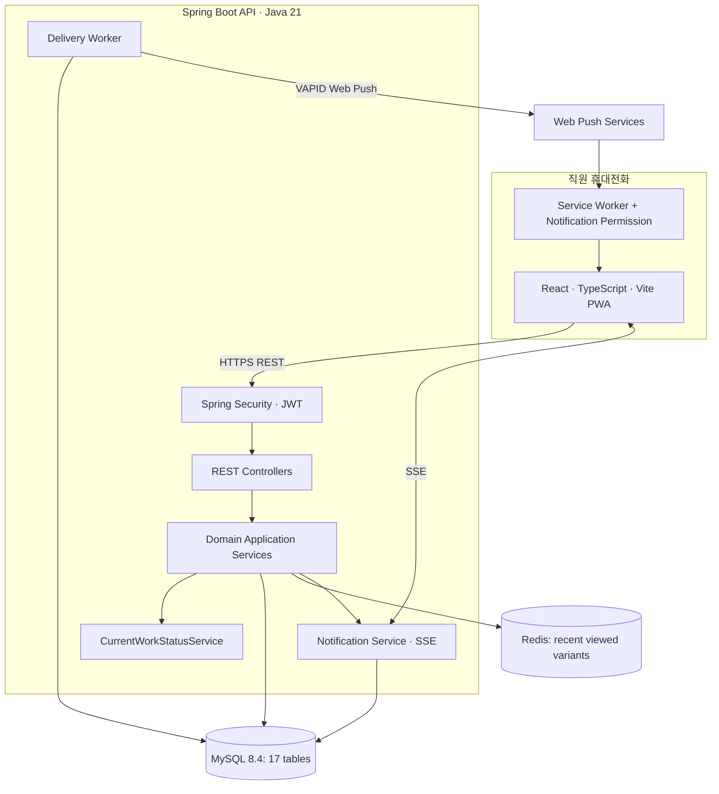
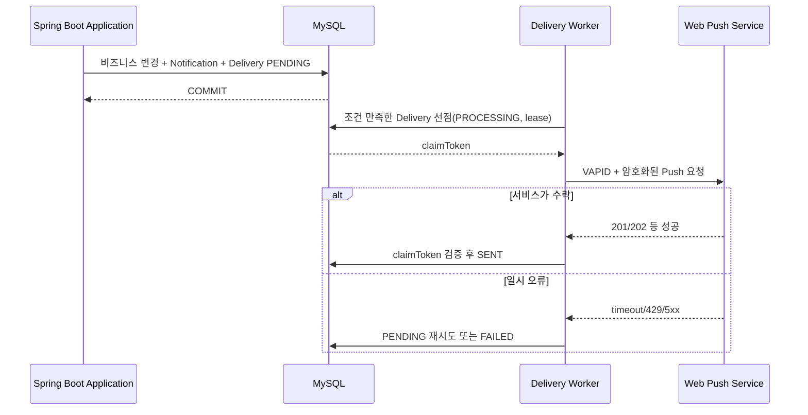

# 05. 기술 아키텍처 및 개발 환경

**설계 기준일:** 2026-11-05 · **구현 대조일:** 2026-11-07.
**[현재]**는 저장소 코드로 확인한 구성, **[권장]**은 미적용 제안이다.
공통 기반과 Store 영속성까지 구현했으며, 아래 목표 아키텍처 전체가 구현된 것은 아니다.
테스트·로컬 기동 결과는 2026-11-07 실행 기록이며 이번 문서 정리에서 재실행하지 않았다.

## 1. 현 저장소와 기술 환경

```text
storeflow/
├── README.md
├── docs/
├── compose.yml                 # MySQL/Redis 로컬 인프라
├── .env.example                # Compose 환경변수 샘플
├── storeflow-backend/           # 실제 생성한 Spring Boot 프로젝트
│   ├── build.gradle
│   ├── settings.gradle
│   ├── gradlew
│   ├── gradle/wrapper/
│   └── src/main/java/com/storeflow/backend/
└── storeflow-frontend/          # 실제 생성한 React/Vite 프로젝트
```

**[현재] 저장소의 `build.gradle`과 Gradle Wrapper**:

| 항목 | 확인 내용 |
|---|---|
| Group | `com.storeflow` |
| Spring Boot | `4.1.2` |
| Java Toolchain | `21` |
| Build | Gradle Wrapper `9.8.2`, Groovy DSL, `io.spring.dependency-management` `1.1.7` |
| Spring | Actuator, Data JPA, Data Redis, Security, Validation, Web MVC |
| Driver | `com.mysql:mysql-connector-j` |
| Migration | Flyway Starter + `flyway-mysql`, V1 stores |
| Test | 분리된 Boot 4 Starter Test 모듈, JUnit Platform Launcher, Testcontainers MySQL |

**실행 확인:** Java 21 / Spring Boot 4.1.2 / Gradle Wrapper 9.8.2에서 빌드·전체 테스트와
로컬 DB/JPA 비웹 기동을 완료했다. 버전 변경 시에는 아래 공식 문서와 실제 빌드로 호환성을 재검증한다.

공식 근거:
- Spring Boot 시스템 요구사항: https://docs.spring.io/spring-boot/system-requirements.html
- Spring Boot 4.1.2 Reference: https://docs.spring.io/spring-boot/reference/
- Spring Boot Build Systems: https://docs.spring.io/spring-boot/reference/using/build-systems.html

## 2. 목표 논리 아키텍처



**MySQL = 업무 상태·이력의 신뢰 원천**, Redis = 부가 최근 조회, SSE = 실행 중 UI 변경 안내, Web Push = 백그라운드 알림. 실시간 알림을 놓쳤다고 해서 업무 상태가 사라지지 않는다.

## 3. 패키지 구조와 구현 범위

**Phase 1 구현(2026-11-07):** 아래 기능 패키지와 `global` 하위 패키지를
`package-info.java`로 구성했다. 실제 공통 코드는 `global.config.ClockConfig`와
`global.error`의 ErrorCode/BusinessException/ApiError/GlobalExceptionHandler이다.
Phase 2-1에서 `store.domain.Store`와 `store.infrastructure.StoreRepository`를 추가했다.
나머지 기능 패키지 및 `global.security`, `global.support`는 `package-info.java`만 존재한다.
아래 트리의 주석은 각 패키지의 목표 책임이며, Clock·오류 처리·Store 영속성 외 코드는 미구현이다.
기능별 api/application/domain/infrastructure는 해당 기능 구현 시 필요한 만큼 추가한다.

Spring Boot는 **package-by-feature**를 기본으로 하고, 너무 이른 시기에 각 기능을 복잡한 멀티모듈로 쪼개지 않는다.

```text
storeflow-backend/src/main/java/com/storeflow/backend/
├── StoreflowBackendApplication.java
├── global/
│   ├── config/             # Clock, Jackson, CORS, OpenAPI, Redis
│   ├── security/           # SecurityFilterChain, JWT, 인증 principal
│   ├── error/              # ErrorCode, BusinessException, GlobalExceptionHandler
│   └── support/            # Pageable/시간/공통 검사 도구
├── auth/                   # signup, login, refresh, AuthSession
├── user/                   # 계정·승인·권한
├── store/                  # 매장
├── workforce/              # WorkSchedule, Attendance, CheckOutNotice
├── staffing/               # SupportRequest, StaffAssignment, CurrentWorkStatus
├── catalog/                # Product, ProductVariant
├── inventory/              # StorageLocation, StockRecord, StockCheckRequest,
│                            # StockVerification
└── notification/           # Notification, Subscription, Delivery, SSE
```

기능별 하위 구조 예시:

```text
inventory/
├── api/            # REST Controller, Request/Response DTO
├── application/    # 업무 유스케이스, @Transactional
├── domain/         # 엔티티, enum, 도메인 규칙
└── infrastructure/ # JPA Repository, Redis 등 영속성 접근
```

개인 프로젝트 MVP에서는 기능당 무조건 4계층을 만들 필요는 없다. 유지보수가 쉬운 크기부터 시작해 필요해질 때 분리한다. `@Transactional`은 API Controller가 아니라 **업무 유스케이스 서비스**에서 경계를 잡는다.

## 4. Spring Boot 의존성

### 4.1 기존 의존성은 유지

사용자가 만든 `build.gradle`의 다음 의존성은 StoreFlow에 적합하다.

```gradle
implementation 'org.springframework.boot:spring-boot-starter-actuator'
implementation 'org.springframework.boot:spring-boot-starter-data-jpa'
implementation 'org.springframework.boot:spring-boot-starter-data-redis'
implementation 'org.springframework.boot:spring-boot-starter-security'
implementation 'org.springframework.boot:spring-boot-starter-validation'
implementation 'org.springframework.boot:spring-boot-starter-webmvc'
runtimeOnly 'com.mysql:mysql-connector-j'
```

`spring-boot-starter-webmvc` 및 도메인별 `*-test` Starter 분리는 Spring Boot 4의 구성과 일치한다. 기존 Test Starter들을 확인 없이 모두 교체하지 않는다.

### 4.2 추가 의존성의 적용 상태

| 적용 상태/도입 시점 | 의존성 | 이유 |
|---|---|---|
| Phase 1 적용 | `org.springframework.boot:spring-boot-starter-flyway` + `org.flywaydb:flyway-mysql` | MySQL 8.4 스키마 버전 관리 |
| Auth 구현 | `org.springframework.boot:spring-boot-starter-security-oauth2-resource-server` | JWT 서명·표준 검증 구성(구체 의존성 확인) |
| 통합 테스트(Phase 2-1 적용) | `spring-boot-testcontainers` + `org.testcontainers:testcontainers-mysql` + `org.testcontainers:testcontainers-junit-jupiter` | Testcontainers 2.x 모듈로 실제 MySQL 제약·마이그레이션 검증 |
| API 완성 | Springdoc OpenAPI, Spring Boot 4 호환 버전 확인 | Swagger UI·계약 검증 |
| Web Push 단계 | Web Push/VAPID Java 라이브러리(호환 검증) | 브라우저 푸시 전송 |

Flyway 의존성은 공식 Spring Boot 데이터베이스 초기화 가이드에 근거한다: https://docs.spring.io/spring-boot/how-to/data-initialization.html . JWT 구현은 `spring-security-oauth2-resource-server`와 JOSE 지원이 필요하므로 실제 Starter/전이 의존성을 확인한다: https://docs.spring.io/spring-security/reference/servlet/oauth2/resource-server/jwt.html .

## 5. 로컬 개발 인프라 [현재]

Spring Boot는 IntelliJ/Gradle로 실행하고, MySQL과 Redis는 루트 `compose.yml`로 실행한다.
별도 `application-local.yml`은 없으며 기본 `application.yaml`에 연결 설정이 있다.

| 항목 | 실제 저장소 구성 |
|---|---|
| MySQL | `mysql:8.4`, 컨테이너명 `storeflow-mysql` |
| MySQL 포트 | `${MYSQL_PORT}:3306`, `.env.example`의 호스트 포트는 3308 |
| MySQL 볼륨 | `mysql_data:/var/lib/mysql` |
| Redis | `redis:7-alpine`, 컨테이너명 `storeflow-redis` |
| Redis 포트 | `${REDIS_PORT}:6379`, `.env.example`의 호스트 포트는 6379 |
| Redis 볼륨 | 서비스에 연결하지 않음. 최상위 `redis_data` 선언만 존재 |
| 포트 바인딩 | MySQL/Redis 모두 호스트 IP를 지정하지 않음 |
| Healthcheck | Compose에 명시하지 않음 |

`.env.example`에는 MYSQL_DATABASE, MYSQL_USER, MYSQL_PASSWORD, MYSQL_ROOT_PASSWORD,
MYSQL_PORT, REDIS_PORT의 개발용 샘플이 있다. 실제 `.env`는 Git 제외 대상이다.
Compose가 읽는 `.env`는 Gradle/Spring Boot에 자동 전달되지 않는다.

`storeflow-backend/src/main/resources/application.yaml`의 실제 설정:

```yaml
spring:
  datasource:
    url: jdbc:mysql://localhost:3308/storeflow
    username: ${DB_USERNAME:storeflow}
    password: ${DB_PASSWORD}
    driver-class-name: com.mysql.cj.jdbc.Driver
  jpa:
    hibernate:
      ddl-auto: validate
    properties:
      hibernate.jdbc.time_zone: UTC
    show-sql: true
  flyway:
    enabled: true
    locations: classpath:db/migration
    baseline-on-migrate: false
    clean-disabled: true
    validate-on-migrate: true
  data:
    redis:
      host: localhost
      port: 6379
```

Compose 계정/포트와 백엔드 설정을 일치시키고, 백엔드 실행 환경에 DB_PASSWORD를 주입한다.
DB_USERNAME은 필요할 때 지정하며 기본값은 storeflow다. 현재 DB URL과 Redis 호스트/포트에는
환경변수 placeholder가 없으므로 Compose 변수만 바꾸면 백엔드 연결 설정은 바뀌지 않는다.

### 5.1 Store 영속성과 Flyway

- V1은 `classpath:db/migration/V1__create_stores.sql`이며 stores만 생성한다.
- `Store`는 `store.domain`, `StoreRepository`는 `store.infrastructure`에 있다.
- 시각은 호출자가 제공한 Instant를 UTC DATETIME(6)으로 저장한다.
- 코드에는 setter가 없고 이름 변경과 비활성화를 지원한다. 재비활성화는 기존 수정 시각을 보존한다.
- Flyway가 스키마를 생성/변경하고 JPA는 validate만 수행한다. 적용된 V1은 수정하지 않는다.
- 이력 없는 비어 있지 않은 DB는 자동 baseline하지 않는다. 기존 스키마를 검토한 후 도입한다.
- Store API/Service, User, 인증·인가 서비스는 미구현이다.

### 5.2 테스트와 검증 기록

공통 컨텍스트 테스트는 `test` 프로파일에서 DataSource/JPA/Flyway 자동 설정과 Redis Repository를
제외한다. 공통 MVC 테스트는 보안 필터를 제외하고 오류 응답 계약만 확인한다.
따라서 공통 테스트 통과는 실제 DB 연결이나 보안 필터의 인증·인가 성공을 의미하지 않는다.

Store 통합 테스트는 이 프로파일 없이 `@DataJpaTest`, Flyway 자동 설정 명시 import,
`@AutoConfigureTestDatabase(replace=NONE)` 및 `@ServiceConnection`을 사용한다.
Boot BOM 관리 Testcontainers 2.0.5로 `mysql:8.4`를 실행하며, 기존 Compose DB/볼륨/3308 포트를
공유하지 않는다. H2 대체나 Docker 부재 시 자동 스킵은 없다.
첫 실행 시 Gradle 의존성과 MySQL/Ryuk 이미지를 내려받으려면 네트워크가 필요할 수 있다.

2026-11-07 저장된 JUnit 결과는 전체 29건 통과(공통 20 + MySQL 9, 실패/스킵 0)다.
같은 날 로컬 MySQL 8.4.11의 빈 storeflow 스키마에 V1을 적용하고 비웹 기동 2회에서
최초 적용, 재실행 no-op, JPA validate를 확인했다. 당시 stores 행은 0개였다.
기존 데이터/볼륨 삭제·재생성, baseline, repair, 임의 시드 입력은 수행하지 않았다.
이는 해당 실행 시점의 기록이며 현재 DB 행 수나 컨테이너 실행 상태를 상시 보장하지 않는다.

### 5.3 실행 명령

```bash
# 저장소 루트: .env.example을 참고해 .env 또는 Compose 환경변수 준비
# 기존 .env가 있다면 덮어쓰지 않고 필요한 설정만 확인
docker compose -f compose.yml up -d
docker compose -f compose.yml ps

# 백엔드: 위 Compose 설정과 일치하는 DB_USERNAME/DB_PASSWORD를 실행 환경에 주입
cd storeflow-backend
./gradlew --version
./gradlew test
./gradlew bootRun

# HTTP 서버 없이 로컬 DB/Flyway/JPA 기동만 점검
./gradlew bootRun --args='--spring.main.web-application-type=none --spring.data.redis.repositories.enabled=false'
```

현재 별도 local 프로파일 설정 파일은 없으므로 기본 설정으로 실행한다.
전체 테스트는 기존 Compose 서비스를 시작하지 않아도 별도의 Docker 컨테이너로 DB 테스트를 수행한다.
일반 웹 모드의 HTTP·인증 검증과 Redis 기능 통합 테스트는 아직 수행 범위에 포함되지 않았다.

### 5.4 미적용 개발 환경 개선안 [권장]

다음은 현재 코드에 적용된 설정이 아니다. 후속 환경 작업에서 필요성을 확인해 적용한다.

- 포트의 호스트 IP를 127.0.0.1로 제한.
- MySQL healthcheck 추가.
- Redis 데이터 보존이 필요하면 선언된 redis_data 볼륨을 서비스에 연결.
- 환경별 연결 설정이 필요해지면 local 프로파일 또는 URL/호스트 환경변수 도입.

## 6. 인증·인가 전략 [목표 · 미구현]

1. **Access JWT:** 짧은 유효기간, issuer/audience/signature/expiration 검증. Access Token은 가급적 브라우저 메모리에만 보관.
2. **Refresh:** MySQL AuthSession에서 해시로 관리, HttpOnly + Secure Cookie, rotate/revoke, 동시 회전·재사용 검출.
3. **계정 상태/권한:** 토큰 서명이 유효해도 사용자 ACTIVE 및 현재 역할/관리 매장을 재검증해야 한다. 관리자 비활성화가 즉시 반영되도록 구성.
4. **서버측 매장 인가:** `@AuthenticationPrincipal`과 DB 연관관계로 매장·직원 리소스를 검증한다. 클라이언트의 `storeId`만 신뢰하지 않는다.
5. **CORS/CSRF:** React 개발 서버 origin을 명시적으로 허용. Refresh 쿠키 요청은 CSRF 보호 및 `Origin` 검증을 적용. 일반 Access Bearer API도 신뢰 가능한 요청 출처를 검토.
6. **보안 로그:** Refresh/Access 원문, 해시·비밀번호·구독 키·endpoint, 직원의 불필요한 개인정보 출력 금지.

가입 대기 계정의 푸시 구독은 생성하지 않는다. 초기 MANAGER는 안전한 부트스트랩/운영자 설정으로만 생성한다.

## 7. Redis — 최근 조회 옵션 [목표 · 미구현]

**키:** `storeflow:recent-products:user:{userId}` · **자료구조:** LIST · **최대 10개** · **TTL 예시:** 7일.

제품 옵션 상세 조회 성공 후 `LREM(key,0,variantId)` → `LPUSH(key,variantId)` → `LTRIM(key,0,9)` → `EXPIRE(key,604800)` 작업을 Lua 또는 Redis 트랜잭션으로 원자화한다. 최근 목록 조회 API는 기록 목록을 변경하지 않는다.

- Redis 장애 시 상품 상세/검색을 실패시키지 않고 최근 조회 기능만 우아하게 저하시킨다.
- Redis를 상품·재고 업무의 소스 오브 트루스로 사용하지 않는다.
- 조회 기록 TTL 갱신은 실제 **상세 조회**를 기준으로 한다.

## 8. DB 정합성과 동시성 [후속 업무 구현 기준]

### 8.1 수락 조건부 UPDATE

```sql
UPDATE stock_check_requests
SET status='ACCEPTED', assigned_to=:userId, accepted_at=CURRENT_TIMESTAMP(6)
WHERE id=:requestId AND status='REQUESTED' AND assigned_to IS NULL;
```

InnoDB의 단일 행 UPDATE는 같은 행에 대한 경쟁을 조정한다. `SELECT` 후 `save()`는 틈이 생길 수 있다. 영향받은 행 수를 확인해 1건 성공, 0건을 후속 상태/권한 검사로 분류한다.

### 8.2 지원 배정 잠금

SupportRequest 행을 잠궈 잔여 정원을 확인하고, User 행을 **ID 오름차순**으로 잠궈 활성 StaffAssignment가 없는지 확인한다. 직원의 현재 근무 자격과 상태가 같은 트랜잭션에서 유효하도록 출퇴근/이동 API의 잠금 규칙을 정렬한다. 잠금 대기, 데드락, 트랜잭션 재시도는 테스트/로그로 점검한다.

### 8.3 재고 확인 완료 트랜잭션

`StockVerification INSERT + StockRecord UPSERT/UPDATE + StockCheckRequest COMPLETED + Notification/Delivery INSERT`는 같은 MySQL 트랜잭션. DB 커밋 전에 외부 Push 호출을 하지 않는다. 버전 충돌/DB UNIQUE/ROLLBACK은 **진짜 MySQL**에서 통합 테스트.

## 9. 알림 아키텍처 [목표 · 미구현]



- **SSE:** 화면이 실행 중일 때 연결을 유지해 변경 이벤트를 수신. Access Token을 URL에 싣지 않으며, `EventSource`의 커스텀 Authorization 헤더 제약 때문에 fetch 기반 클라이언트 고려.
- **Web Push:** 브라우저 Service Worker/Push API/Notifications API + VAPID. iOS/iPadOS 16.4+에서는 **홈 화면에 추가한 웹 앱**에 대한 Web Push 지원이 도입되었으므로 실기기 및 설치 조건을 검증한다. 공식 근거: https://webkit.org/blog/13878/ .
- **전송 작업:** PENDING/PROCESSING/SENT/FAILED, 시도 횟수, `nextAttemptAt`, `lockedUntil`, claimToken. 전송 성공은 공급자 수락이지 단말 수신 보장이 아니다.
- **복구:** 작업 Worker 크래시 → lease 만료 후 회수. 외부 서비스가 수락한 직후 Worker 크래시 시 중복 수신 가능성을 완전히 제거할 수 없다.
- **수신자 권한:** 요청 당시 현재 근무 매장으로 알림을 저장하고, 푸시 전송 직전 현재 WORKING 여부/업무 상태를 재검증해 오래된 업무 알림을 생략한다.
- **SSE 확장:** 단일 서버에서 시작; 다중 서버가 되면 Redis Pub/Sub 등의 브로드캐스트 고려. Redis 메시지를 영속 알림 저장으로 대체하지 않는다.

## 10. 프론트엔드/PWA [목표 · 기능 미구현]

- React + TypeScript + Vite. 우선 UI는 로그인/승인 상태, 홈 대시보드, 내 근무, 상품 검색/상세/창고 위치, 재고 확인 업무, 지원 업무, 알림함 순서로 구현.
- PWA 필수: HTTPS(로컬호스트 예외), Manifest, 설치 아이콘, Service Worker, 권한 요청 후 Push Subscription 등록.
- 사용자별 업무/API 응답과 토큰을 서비스 워커의 공용 오프라인 캐시에 보관하지 않는다. 권한 데이터 누출·계정 전환 위험에 주의한다.
- 모바일 푸시가 불가능한 기기에서도 **알림함과 업무 목록**으로 업무를 계속 사용할 수 있어야 한다.
- PWA와 Native 앱 중 장기 선택은 실기기 사용성 검증 결과로 결정; MVP는 PWA 우선.

## 11. 관측·배포·비밀 관리

- Actuator health/metrics: DB 상태를 핵심 준비 상태에 포함하고, Redis 부가 장애만으로 전체 업무를 일률적으로 중단하지 않도록 분류.
- 메트릭 후보: 재고 수락 충돌 수, 지원 중복 배정 거부 수, 미수락 업무 수, Delivery PENDING 지연, 푸시 실패율, Redis 사용 실패.
- 운영 로그: traceId, requestId, worker claim ID, SQL deadlock 오류, 알림 타입; 실제 토큰/계정 비밀번호/구독 키 출력 금지.
- 로컬: Docker Compose MySQL·Redis + IntelliJ/Gradle 백엔드 + Vite 개발 서버.
- 배포 후보: HTTPS 리버스 프록시 또는 ALB, 백엔드 컨테이너, RDS MySQL, 정적 PWA 호스팅, 필요 시 관리형 Redis. AWS 구조·비용은 검증 후 결정.
- 스키마: Flyway 버전 관리, 테스트 DB/운영 DB의 스키마 일치, 백업·복구 훈련, 마이그레이션 실패 시 배포 중지.
- 루트 `.gitignore`는 `.DS_Store`, `.idea/`, `.env`, 백엔드 build와 프론트엔드 node_modules 등 생성 파일을 제외한다. 현재 Git 추적 목록에서 `.idea/`와 `.DS_Store` 항목은 조회되지 않는다.

## 12. 개발 환경 확인 범위

- [x] Java 21 / Spring Boot 4.1.2 / Gradle Wrapper 9.8.2 빌드·테스트 실행.
- [x] 기본 application.yaml로 로컬 DB/Flyway/JPA 비웹 기동 검증(2026-11-07 기록).
- [x] Store V1 최초 적용·재실행과 ddl-auto=validate 통과.
- [x] 전체 테스트 29건 통과 기록.
- [ ] 일반 웹 모드의 HTTP 및 실제 인증·인가 동작 검증.
- [ ] Redis 연결/기능 통합 테스트.

Spring Security Starter는 존재하지만 JWT와 사용자 자격 검증 코드는 없다.
전체 API를 permitAll로 열지 않고, 각 업무 API 도입 시 보안 필터와 권한 검증을 함께 구현한다.

[테스트와 단계별 구현 계획](07-development-plan.md)에 따라 확장한다.
