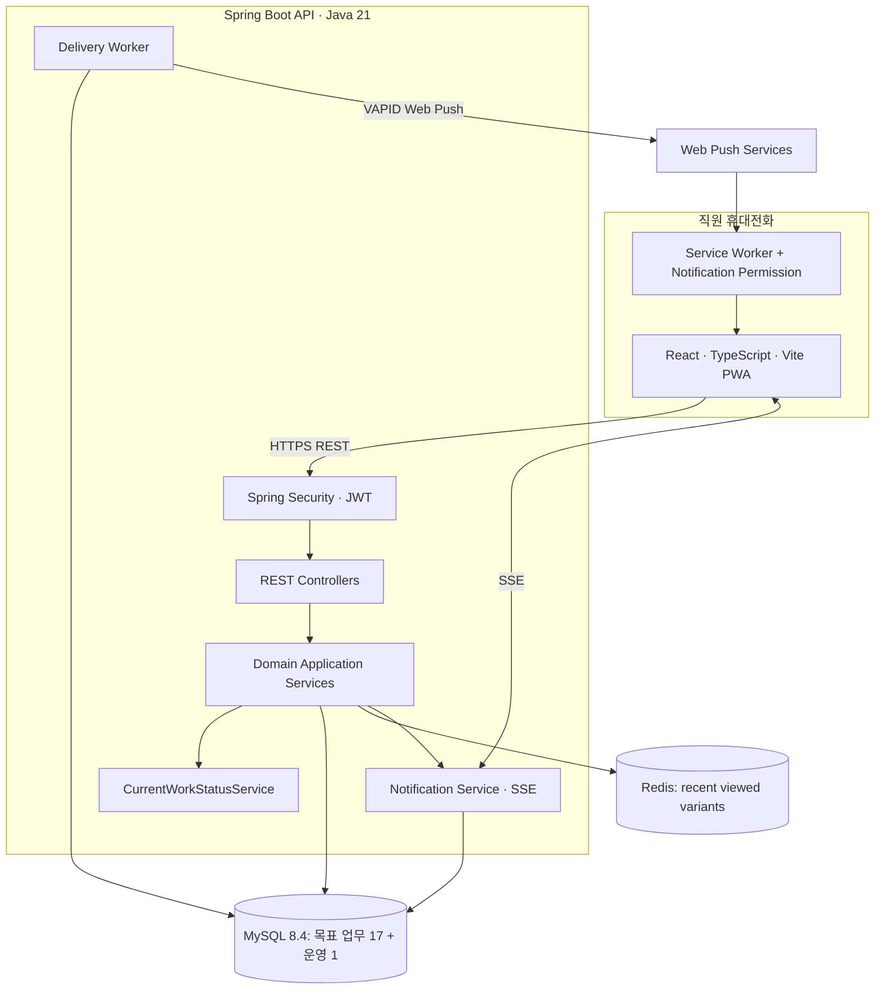
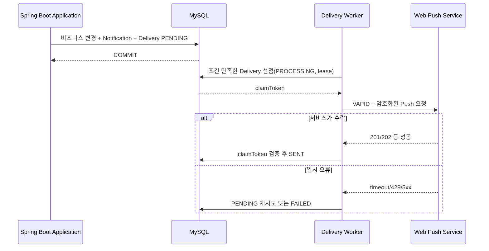

# 05. 기술 아키텍처 및 개발 환경

**설계 기준일:** 2026-11-05 · **구현 대조일:** 2026-11-11.
**[현재]**는 저장소 코드로 확인한 구성, **[권장]**은 미적용 제안이다.
공통 기반과 Store·User 영속성, 회원가입 API, 초기 MANAGER 생성·인가 서비스 및 Store 조회/관리 및 관리자 가입 심사 API 및 로그인·Access/Refresh·로그아웃·근무 일정 API까지 구현했으며, 아래 목표 아키텍처 전체가 구현된 것은 아니다.
로컬 기동 결과는 2026-11-07 기록이다. 2026-11-09 회원가입 구현 후 전체 테스트 79건을 통과했으며, 이는 기존 Compose DB 기동 검증과 별개다.

## 1. 현 저장소와 기술 환경

```text
jashop/
├── README.md
├── docs/
├── compose.yml                 # MySQL/Redis 로컬 인프라
├── .env.example                # Compose 환경변수 샘플
├── jashop-backend/           # 실제 생성한 Spring Boot 프로젝트
│   ├── build.gradle
│   ├── settings.gradle
│   ├── gradlew
│   ├── gradle/wrapper/
│   └── src/main/java/com/jashop/backend/
└── jashop-frontend/          # 실제 생성한 React/Vite 프로젝트
```

**[현재] 저장소의 `build.gradle`과 Gradle Wrapper**:

| 항목 | 확인 내용 |
|---|---|
| Group | `com.jashop` |
| Spring Boot | `4.1.2` |
| Java Toolchain | `21` |
| Build | Gradle Wrapper `9.8.2`, Groovy DSL, `io.spring.dependency-management` `1.1.7` |
| Spring | Actuator, Data JPA, Data Redis, Security, Validation, Web MVC |
| Driver | `com.mysql:mysql-connector-j` |
| Migration | Flyway Starter + `flyway-mysql`, V1 stores / V2 users / V3 manager_bootstrap / V4 rejection_reason |
| Test | 분리된 Boot 4 Starter Test 모듈, JUnit Platform Launcher, Testcontainers MySQL |

**실행 확인:** Java 21 / Spring Boot 4.1.2 / Gradle Wrapper 9.8.2에서 빌드·전체 테스트와
로컬 DB/JPA 비웹 기동을 완료했다. 버전 변경 시에는 아래 공식 문서와 실제 빌드로 호환성을 재검증한다.

공식 근거:
- Spring Boot 시스템 요구사항: https://docs.spring.io/spring-boot/system-requirements.html
- Spring Boot 4.1.2 Reference: https://docs.spring.io/spring-boot/reference/
- Spring Boot Build Systems: https://docs.spring.io/spring-boot/reference/using/build-systems.html

## 2. 목표 논리 아키텍처



**MySQL = 업무 상태·이력의 신뢰 원천**, Redis = 부가 최근 조회, SSE = 실행 중 UI 변경 안내, Web Push = 백그라운드 알림. 실시간 알림을 놓쳤다고 해서 업무 상태가 사라지지 않는다.

## 3. 패키지 구조와 구현 범위

**Phase 1 구현(2026-11-07):** 아래 기능 패키지와 `global` 하위 패키지를
`package-info.java`로 구성했다. 실제 공통 코드는 `global.config.ClockConfig`와
`global.error`의 ErrorCode/BusinessException/ApiError/GlobalExceptionHandler이다.
Phase 2-1에서 `store.domain.Store`와 `store.infrastructure.StoreRepository`를 추가했다.
User에 `user.domain.User`/역할·상태 enum과 `user.infrastructure.UserRepository`를 추가했다.
나머지 기능 패키지 및 `global.security`, `global.support`는 `package-info.java`만 존재한다.
아래 트리의 주석은 각 패키지의 목표 책임이며, Clock·오류 처리·Store/User 영속성·회원가입·초기 관리자 생성·인가 서비스·Store API 외 코드는 미구현이다.
기능별 api/application/domain/infrastructure는 해당 기능 구현 시 필요한 만큼 추가한다.

Spring Boot는 **package-by-feature**를 기본으로 하고, 너무 이른 시기에 각 기능을 복잡한 멀티모듈로 쪼개지 않는다.

```text
jashop-backend/src/main/java/com/jashop/backend/
├── JashopBackendApplication.java
├── global/
│   ├── config/             # Clock, Jackson, CORS, OpenAPI, Redis
│   ├── security/           # SecurityFilterChain, JWT, 인증 principal
│   ├── error/              # ErrorCode, BusinessException, GlobalExceptionHandler
│   └── support/            # Pageable/시간/공통 검사 도구
├── auth/                   # signup, login, refresh, AuthSession
├── user/                   # 계정·승인·권한
├── store/                  # 매장
├── workforce/              # WorkSchedule, Attendance, CheckOutNotice
├── staffing/               # SupportRequest, StaffAssignment, CurrentWorkStatus
├── catalog/                # Product, ProductVariant
├── inventory/              # StorageLocation, StockRecord, StockCheckRequest,
│                            # StockVerification
└── notification/           # Notification, Subscription, Delivery, SSE
```

기능별 하위 구조 예시:

```text
inventory/
├── api/            # REST Controller, Request/Response DTO
├── application/    # 업무 유스케이스, @Transactional
├── domain/         # 엔티티, enum, 도메인 규칙
└── infrastructure/ # JPA Repository, Redis 등 영속성 접근
```

개인 프로젝트 MVP에서는 기능당 무조건 4계층을 만들 필요는 없다. 유지보수가 쉬운 크기부터 시작해 필요해질 때 분리한다. `@Transactional`은 API Controller가 아니라 **업무 유스케이스 서비스**에서 경계를 잡는다.

## 4. Spring Boot 의존성

### 4.1 기존 의존성은 유지

사용자가 만든 `build.gradle`의 다음 의존성은 jashop에 적합하다.

```gradle
implementation 'org.springframework.boot:spring-boot-starter-actuator'
implementation 'org.springframework.boot:spring-boot-starter-data-jpa'
implementation 'org.springframework.boot:spring-boot-starter-data-redis'
implementation 'org.springframework.boot:spring-boot-starter-security'
implementation 'org.springframework.boot:spring-boot-starter-validation'
implementation 'org.springframework.boot:spring-boot-starter-webmvc'
runtimeOnly 'com.mysql:mysql-connector-j'
```

`spring-boot-starter-webmvc` 및 도메인별 `*-test` Starter 분리는 Spring Boot 4의 구성과 일치한다. 기존 Test Starter들을 확인 없이 모두 교체하지 않는다.

### 4.2 추가 의존성의 적용 상태

| 적용 상태/도입 시점 | 의존성 | 이유 |
|---|---|---|
| Phase 1 적용 | `org.springframework.boot:spring-boot-starter-flyway` + `org.flywaydb:flyway-mysql` | MySQL 8.4 스키마 버전 관리 |
| Auth 구현 | `org.springframework.boot:spring-boot-starter-security-oauth2-resource-server` | JWT 서명·표준 검증 구성(구체 의존성 확인) |
| 통합 테스트(Phase 2-1 적용) | `spring-boot-testcontainers` + `org.testcontainers:testcontainers-mysql` + `org.testcontainers:testcontainers-junit-jupiter` | Testcontainers 2.x 모듈로 실제 MySQL 제약·마이그레이션 검증 |
| API 완성 | Springdoc OpenAPI, Spring Boot 4 호환 버전 확인 | Swagger UI·계약 검증 |
| Web Push 단계 | Web Push/VAPID Java 라이브러리(호환 검증) | 브라우저 푸시 전송 |

Flyway 의존성은 공식 Spring Boot 데이터베이스 초기화 가이드에 근거한다: https://docs.spring.io/spring-boot/how-to/data-initialization.html . JWT 구현은 `spring-security-oauth2-resource-server`와 JOSE 지원이 필요하므로 실제 Starter/전이 의존성을 확인한다: https://docs.spring.io/spring-security/reference/servlet/oauth2/resource-server/jwt.html .

## 5. 로컬 개발 인프라 [현재]

Spring Boot는 IntelliJ/Gradle로 실행하고, MySQL과 Redis는 루트 `compose.yml`로 실행한다.
별도 `application-local.yml`은 없으며 기본 `application.yaml`에 연결 설정이 있다.

| 항목 | 실제 저장소 구성 |
|---|---|
| MySQL | `mysql:8.4`, 컨테이너명 `jashop-mysql` |
| MySQL 포트 | `${MYSQL_PORT}:3306`, `.env.example`의 호스트 포트는 3308 |
| MySQL 볼륨 | `mysql_data:/var/lib/mysql` |
| Redis | `redis:7-alpine`, 컨테이너명 `jashop-redis` |
| Redis 포트 | `${REDIS_PORT}:6379`, `.env.example`의 호스트 포트는 6379 |
| Redis 볼륨 | 서비스에 연결하지 않음. 최상위 `redis_data` 선언만 존재 |
| 포트 바인딩 | MySQL/Redis 모두 호스트 IP를 지정하지 않음 |
| Healthcheck | Compose에 명시하지 않음 |

`.env.example`에는 MYSQL_DATABASE, MYSQL_USER, MYSQL_PASSWORD, MYSQL_ROOT_PASSWORD,
MYSQL_PORT, REDIS_PORT의 개발용 샘플이 있다. 실제 `.env`는 Git 제외 대상이다.
Compose가 읽는 `.env`는 Gradle/Spring Boot에 자동 전달되지 않는다.

`jashop-backend/src/main/resources/application.yaml`의 실제 설정:

```yaml
spring:
  datasource:
    url: jdbc:mysql://localhost:3308/jashop
    username: ${DB_USERNAME:jashop}
    password: ${DB_PASSWORD}
    driver-class-name: com.mysql.cj.jdbc.Driver
  jpa:
    hibernate:
      ddl-auto: validate
    properties:
      hibernate.jdbc.time_zone: UTC
    show-sql: true
  flyway:
    enabled: true
    locations: classpath:db/migration
    baseline-on-migrate: false
    clean-disabled: true
    validate-on-migrate: true
  data:
    redis:
      host: localhost
      port: 6379
```

Compose 계정/포트와 백엔드 설정을 일치시키고, 백엔드 실행 환경에 DB_PASSWORD를 주입한다.
DB_USERNAME은 필요할 때 지정하며 기본값은 jashop이다. 현재 DB URL과 Redis 호스트/포트에는
환경변수 placeholder가 없으므로 Compose 변수만 바꾸면 백엔드 연결 설정은 바뀌지 않는다.

### 5.1 Store 영속성과 Flyway

- V1은 `classpath:db/migration/V1__create_stores.sql`이며 stores만 생성한다.
- `Store`는 `store.domain`, `StoreRepository`는 `store.infrastructure`에 있다.
- 시각은 호출자가 제공한 Instant를 UTC DATETIME(6)으로 저장한다.
- 코드에는 setter가 없고 이름 변경과 비활성화를 지원한다. 재비활성화는 기존 수정 시각을 보존한다.
- Flyway가 스키마를 생성/변경하고 JPA는 validate만 수행한다. 적용된 V1은 수정하지 않는다.
- 이력 없는 비어 있지 않은 DB는 자동 baseline하지 않는다. 기존 스키마를 검토한 후 도입한다.
- V2는 users를 추가하며 User는 ID 기반 매장/승인자 참조와 문자열 enum을 사용한다. `@JdbcTypeCode(VARCHAR)`로 MySQL native ENUM 대신 ERD의 VARCHAR 매핑을 유지한다.
- 회원가입은 `auth.api` DTO/Controller → `auth.application.SignupService` → `UserRepository`로 구성한다. 서비스 트랜잭션에서 BCrypt 해시와 Clock 시각을 사용하며 saveAndFlush로 동시 중복 예외를 변환한다.
- 초기 MANAGER 생성은 auth.bootstrap, 인가 서비스는 user.application에 구현했다. Store API/Service와 관리자 가입 심사 API는 인가 서비스와 연결했으며 로그인·Access JWT는 3-1, Refresh/로그아웃 및 즉시 Access 차단은 3-2로 구현했다.

### 5.2 테스트와 검증 기록

공통 컨텍스트 테스트는 `test` 프로파일에서 DataSource/JPA/Flyway 자동 설정과 Redis Repository를
제외한다. 공통 MVC 테스트는 보안 필터를 제외하고 오류 응답 계약만 확인한다.
따라서 공통 테스트 통과는 실제 DB 연결이나 보안 필터의 인증·인가 성공을 의미하지 않는다.

Store 통합 테스트는 이 프로파일 없이 `@DataJpaTest`, Flyway 자동 설정 명시 import,
`@AutoConfigureTestDatabase(replace=NONE)` 및 `@ServiceConnection`을 사용한다.
Boot BOM 관리 Testcontainers 2.0.5로 `mysql:8.4`를 실행하며, 기존 Compose DB/볼륨/3308 포트를
공유하지 않는다. H2 대체나 Docker 부재 시 자동 스킵은 없다.
첫 실행 시 Gradle 의존성과 MySQL/Ryuk 이미지를 내려받으려면 네트워크가 필요할 수 있다.

2026-11-07 저장된 JUnit 결과는 전체 29건 통과(공통 20 + MySQL 9, 실패/스킵 0)다.
같은 날 이름 변경 전 로컬 MySQL 8.4.11의 빈 스키마에 V1을 적용하고 비웹 기동 2회에서
최초 적용, 재실행 no-op, JPA validate를 확인했다. 당시 stores 행은 0개였다.
기존 데이터/볼륨 삭제·재생성, baseline, repair, 임의 시드 입력은 수행하지 않았다.
이는 해당 실행 시점의 기록이며 현재 DB 행 수나 컨테이너 실행 상태를 상시 보장하지 않는다.

### 5.3 실행 명령

```bash
# 저장소 루트: .env.example을 참고해 .env 또는 Compose 환경변수 준비
# 기존 .env가 있다면 덮어쓰지 않고 필요한 설정만 확인
docker compose -f compose.yml up -d
docker compose -f compose.yml ps

# 백엔드: 위 Compose 설정과 일치하는 DB_USERNAME/DB_PASSWORD를 실행 환경에 주입
cd jashop-backend
./gradlew --version
./gradlew test
./gradlew bootRun

# HTTP 서버 없이 로컬 DB/Flyway/JPA 기동만 점검
./gradlew bootRun --args='--spring.main.web-application-type=none --spring.data.redis.repositories.enabled=false'
```

현재 별도 local 프로파일 설정 파일은 없으므로 기본 설정으로 실행한다.
전체 테스트는 기존 Compose 서비스를 시작하지 않아도 별도의 Docker 컨테이너로 DB 테스트를 수행한다.
일반 웹 모드의 HTTP·인증 검증과 Redis 기능 통합 테스트는 아직 수행 범위에 포함되지 않았다.

### 5.4 미적용 개발 환경 개선안 [권장]

다음은 현재 코드에 적용된 설정이 아니다. 후속 환경 작업에서 필요성을 확인해 적용한다.

- 포트의 호스트 IP를 127.0.0.1로 제한.
- MySQL healthcheck 추가.
- Redis 데이터 보존이 필요하면 선언된 redis_data 볼륨을 서비스에 연결.
- 환경별 연결 설정이 필요해지면 local 프로파일 또는 URL/호스트 환경변수 도입.

## 6. 인증·인가 전략 [로그인·JWT·Refresh·로그아웃 구현]

**현재:** `PasswordConfig`는 DelegatingPasswordEncoder + BCrypt(12)를 제공한다. 기존 Security 의존성만 사용하며 새 라이브러리는 추가하지 않았다. 비밀번호 원문과 해시는 응답·DTO 문자열 표현에 노출하지 않는다.
`SecurityConfig`는 가입 POST 공개 체인, 로그인/refresh/logout/csrf 쿠키 체인, 나머지 Bearer 체인으로 분리한다. HTTP 세션 인증과 Basic/Form은 사용하지 않는다. 쿠키 인증 POST는 CSRF/Origin을 검사하고 Bearer 업무 API는 기존 DB 인가를 유지한다. 현재 계약은 마지막의 Phase 3-2 절을 따른다.

비밀번호 길이 검증은 BCrypt의 72바이트 한계에서 조용한 잘림/런타임 오류를 방지한다. 비용 12의 운영 응답 시간과 부하는 배포 환경에서 별도로 측정한다.

아래는 후속 인증·인가 목표다.

1. **Access JWT:** 짧은 유효기간, issuer/audience/signature/expiration 검증. Access Token은 가급적 브라우저 메모리에만 보관.
2. **Refresh:** MySQL AuthSession에서 해시로 관리, HttpOnly + Secure Cookie, rotate/revoke, 동시 회전·재사용 검출.
3. **계정 상태/권한:** 토큰 서명이 유효해도 사용자 ACTIVE 및 현재 역할/관리 매장을 재검증해야 한다. 관리자 비활성화가 즉시 반영되도록 구성.
4. **서버측 매장 인가:** `@AuthenticationPrincipal`과 DB 연관관계로 매장·직원 리소스를 검증한다. 클라이언트의 `storeId`만 신뢰하지 않는다.
5. **CORS/CSRF:** React 개발 서버 origin을 명시적으로 허용. Refresh 쿠키 요청은 CSRF 보호 및 `Origin` 검증을 적용. 일반 Access Bearer API도 신뢰 가능한 요청 출처를 검토.
6. **보안 로그:** Refresh/Access 원문, 해시·비밀번호·구독 키·endpoint, 직원의 불필요한 개인정보 출력 금지.

가입 대기 계정의 푸시 구독은 생성하지 않는다. 초기 MANAGER는 아래 운영자 전용 절차로만 생성한다.

### 6.1 초기 관리자 생성 및 인가 기반 (2026-11-10)

- 기본 비활성인 ManagerBootstrapRunner를 `JASHOP_BOOTSTRAP_ENABLED=true`와 명시적인 비웹 모드에서만 실행한다. SecurityConfig는 Servlet 웹 환경에만 적용한다.
- V3의 단일 행을 잠그고 완료 이력 또는 기존 MANAGER(상태 무관)가 있으면 거부한다. 기존 이메일을 승격/덮어쓰기하지 않는다. 사용자와 완료 기록은 한 트랜잭션으로 저장하며 최초 관리자에게 승인자는 없다.
- UserAuthorizationService의 requireActive/requireManager/requireStoreAssistantManager는 DB의 현재 계정 상태와 역할·homeStoreId를 검사한다. 부매니저 전용 명령에는 MANAGER도 자동 우회하지 않는다.
- userId는 향후 검증된 principal에서 전달해야 한다. Store HTTP API에는 UserPrincipal을 통해 연결했으나 실제 principal을 발급하는 로그인/JWT는 미구현이며 매장 존재·활성, 현재 근무 위치 및 업무 상태 검증은 각 후속 명령에서 추가한다. 외부 트랜잭션의 JPA 영속성 컨텍스트를 무시하는 강제 재조회나 권한 변경과 명령 사이의 동시성 잠금은 제공하지 않는다.
- 실행 방법과 비밀값 주입은 README의 초기 관리자 절차를 따른다.

## 7. Redis — 최근 조회 옵션 [목표 · 미구현]

**키:** `jashop:recent-products:user:{userId}` · **자료구조:** LIST · **최대 10개** · **TTL 예시:** 7일.

제품 옵션 상세 조회 성공 후 `LREM(key,0,variantId)` → `LPUSH(key,variantId)` → `LTRIM(key,0,9)` → `EXPIRE(key,604800)` 작업을 Lua 또는 Redis 트랜잭션으로 원자화한다. 최근 목록 조회 API는 기록 목록을 변경하지 않는다.

- Redis 장애 시 상품 상세/검색을 실패시키지 않고 최근 조회 기능만 우아하게 저하시킨다.
- Redis를 상품·재고 업무의 소스 오브 트루스로 사용하지 않는다.
- 조회 기록 TTL 갱신은 실제 **상세 조회**를 기준으로 한다.

## 8. DB 정합성과 동시성 [후속 업무 구현 기준]

### 8.1 수락 조건부 UPDATE

```sql
UPDATE stock_check_requests
SET status='ACCEPTED', assigned_to=:userId, accepted_at=CURRENT_TIMESTAMP(6)
WHERE id=:requestId AND status='REQUESTED' AND assigned_to IS NULL;
```

InnoDB의 단일 행 UPDATE는 같은 행에 대한 경쟁을 조정한다. `SELECT` 후 `save()`는 틈이 생길 수 있다. 영향받은 행 수를 확인해 1건 성공, 0건을 후속 상태/권한 검사로 분류한다.

### 8.2 지원 배정 잠금

SupportRequest 행을 잠궈 잔여 정원을 확인하고, User 행을 **ID 오름차순**으로 잠궈 활성 StaffAssignment가 없는지 확인한다. 직원의 현재 근무 자격과 상태가 같은 트랜잭션에서 유효하도록 출퇴근/이동 API의 잠금 규칙을 정렬한다. 잠금 대기, 데드락, 트랜잭션 재시도는 테스트/로그로 점검한다.

### 8.3 재고 확인 완료 트랜잭션

`StockVerification INSERT + StockRecord UPSERT/UPDATE + StockCheckRequest COMPLETED + Notification/Delivery INSERT`는 같은 MySQL 트랜잭션. DB 커밋 전에 외부 Push 호출을 하지 않는다. 버전 충돌/DB UNIQUE/ROLLBACK은 **진짜 MySQL**에서 통합 테스트.

## 9. 알림 아키텍처 [목표 · 미구현]



- **SSE:** 화면이 실행 중일 때 연결을 유지해 변경 이벤트를 수신. Access Token을 URL에 싣지 않으며, `EventSource`의 커스텀 Authorization 헤더 제약 때문에 fetch 기반 클라이언트 고려.
- **Web Push:** 브라우저 Service Worker/Push API/Notifications API + VAPID. iOS/iPadOS 16.4+에서는 **홈 화면에 추가한 웹 앱**에 대한 Web Push 지원이 도입되었으므로 실기기 및 설치 조건을 검증한다. 공식 근거: https://webkit.org/blog/13878/ .
- **전송 작업:** PENDING/PROCESSING/SENT/FAILED, 시도 횟수, `nextAttemptAt`, `lockedUntil`, claimToken. 전송 성공은 공급자 수락이지 단말 수신 보장이 아니다.
- **복구:** 작업 Worker 크래시 → lease 만료 후 회수. 외부 서비스가 수락한 직후 Worker 크래시 시 중복 수신 가능성을 완전히 제거할 수 없다.
- **수신자 권한:** 요청 당시 현재 근무 매장으로 알림을 저장하고, 푸시 전송 직전 현재 WORKING 여부/업무 상태를 재검증해 오래된 업무 알림을 생략한다.
- **SSE 확장:** 단일 서버에서 시작; 다중 서버가 되면 Redis Pub/Sub 등의 브로드캐스트 고려. Redis 메시지를 영속 알림 저장으로 대체하지 않는다.

## 10. 프론트엔드/PWA [목표 · 기능 미구현]

- React + TypeScript + Vite. 우선 UI는 로그인/승인 상태, 홈 대시보드, 내 근무, 상품 검색/상세/창고 위치, 재고 확인 업무, 지원 업무, 알림함 순서로 구현.
- PWA 필수: HTTPS(로컬호스트 예외), Manifest, 설치 아이콘, Service Worker, 권한 요청 후 Push Subscription 등록.
- 사용자별 업무/API 응답과 토큰을 서비스 워커의 공용 오프라인 캐시에 보관하지 않는다. 권한 데이터 누출·계정 전환 위험에 주의한다.
- 모바일 푸시가 불가능한 기기에서도 **알림함과 업무 목록**으로 업무를 계속 사용할 수 있어야 한다.
- PWA와 Native 앱 중 장기 선택은 실기기 사용성 검증 결과로 결정; MVP는 PWA 우선.

## 11. 관측·배포·비밀 관리

- Actuator health/metrics: DB 상태를 핵심 준비 상태에 포함하고, Redis 부가 장애만으로 전체 업무를 일률적으로 중단하지 않도록 분류.
- 메트릭 후보: 재고 수락 충돌 수, 지원 중복 배정 거부 수, 미수락 업무 수, Delivery PENDING 지연, 푸시 실패율, Redis 사용 실패.
- 운영 로그: traceId, requestId, worker claim ID, SQL deadlock 오류, 알림 타입; 실제 토큰/계정 비밀번호/구독 키 출력 금지.
- 로컬: Docker Compose MySQL·Redis + IntelliJ/Gradle 백엔드 + Vite 개발 서버.
- 배포 후보: HTTPS 리버스 프록시 또는 ALB, 백엔드 컨테이너, RDS MySQL, 정적 PWA 호스팅, 필요 시 관리형 Redis. AWS 구조·비용은 검증 후 결정.
- 스키마: Flyway 버전 관리, 테스트 DB/운영 DB의 스키마 일치, 백업·복구 훈련, 마이그레이션 실패 시 배포 중지.
- 루트 `.gitignore`는 `.DS_Store`, `.idea/`, `.env`, 백엔드 build와 프론트엔드 node_modules 등 생성 파일을 제외한다. 현재 Git 추적 목록에서 `.idea/`와 `.DS_Store` 항목은 조회되지 않는다.

## 12. 개발 환경 확인 범위

- [x] Java 21 / Spring Boot 4.1.2 / Gradle Wrapper 9.8.2 빌드·테스트 실행.
- [x] 기본 application.yaml로 로컬 DB/Flyway/JPA 비웹 기동 검증(2026-11-07 기록).
- [x] Store V1 최초 적용·재실행과 ddl-auto=validate 통과.
- [x] 전체 테스트 29건 통과 기록.
- [ ] 일반 웹 모드의 HTTP 및 실제 인증·인가 동작 검증.
- [ ] Redis 연결/기능 통합 테스트.

Spring Security 기반 로그인/Access JWT 검증 및 DB 계정 상태·역할 인가를 구현했다. Refresh/AuthSession은 후속 단계다.
전체 API를 permitAll로 열지 않고, 각 업무 API 도입 시 보안 필터와 권한 검증을 함께 구현한다.

[테스트와 단계별 구현 계획](07-development-plan.md)에 따라 확장한다.


## Store API 구현 상세 (2026-11-10)

- store.api의 Controller/DTO → store.application.StoreService → StoreRepository/Store 구조다. 서비스에서 UserAuthorizationService를 호출하고 응답 DTO를 생성한다.
- UserPrincipal은 인증된 사용자 ID만 담으며 역할/상태는 DB에서 확인한다. 요청 본문·임의 헤더로 principal을 생성하는 기능은 없다. 인증 완료 여부와 principal 타입을 검사하므로 Boot 기본 로그인 사용자도 Store 사용자로 간주하지 않는다.
- 목록은 findByActive와 PageRequest로 필터·페이지·ID ASC를 DB에서 처리하며 응답은 명시적 StorePageResponse로 고정한다. 상세는 활성 여부와 무관하게 조회한다.
- 이름 변경/비활성화는 동일 트랜잭션에서 findByIdForUpdate(PESSIMISTIC_WRITE)로 로드하고 dirty checking으로 저장한다. 변경 전 최신 행을 잠가 읽어 비활성 상태가 이름 변경으로 덮어써지는 것을 방지한다. 잠금은 Store 행에 대한 것으로 계정 권한 변경까지 직렬화하지는 않는다.
- ApiSecurityErrorHandler는 Store 필터의 인증/접근 거부를 공통 ApiError(JSON, Clock, 서버 traceId)로 반환한다. 다른 경로의 기존 인증/CSRF 정책은 유지한다.
- 아직 로그인/JWT 제공자가 없어 실제 계정으로 HTTP 호출할 수 없다. Store API 통합 테스트는 테스트 인증 객체를 주입하고 운영 필터와 실제 MySQL을 사용한다. 새 라이브러리·마이그레이션은 추가하지 않는다.


## 관리자 가입 심사 구현 상세 (2026-11-10)

- user.api.UserReviewController/DTO → user.application.UserReviewService → UserRepository/StoreRepository 및 User 도메인 메서드로 구성한다. 기존 UserPrincipal/인가 서비스를 사용한다.
- pending은 readOnly 트랜잭션, approve/reject는 쓰기 트랜잭션이다. 상태 전이 규칙은 User.requirePending/approve/reject에도 두어 서비스 밖에서도 잘못된 재심사를 막는다.
- 승인 잠금 순서는 대상 User(PESSIMISTIC_WRITE) → Store(PESSIMISTIC_WRITE), 거절은 대상 User만 잠근다. Store 관리 명령은 기존 Store 잠금 규칙을 유지한다. 현재 구현에 Store → 대상 User 잠금을 획득하는 역순 경로는 없다.
- Store 잠금은 승인 시 ACTIVE 검사와 승인 저장 사이의 비활성화 경쟁을 방지한다. 이후 비활성화까지 금지하는 정책은 아니다. 요청자 권한 변경과의 경쟁, DB 잠금 timeout/자동 재시도는 별도 후속 과제다.
- 선택적 거절 사유를 보존하기 위해 V4를 추가하며 기존 V1~V3는 변경하지 않는다. rejection_reason은 nullable VARCHAR(500), 기존 데이터는 null로 보존된다. 로그인/JWT나 알림 기능은 추가하지 않는다.
- 기존 StoreSecurityErrorHandler를 ApiSecurityErrorHandler로 이름 변경해 Store/관리자 User 필터에서 재사용한다. 두 보호 체인은 Basic/Form 인증을 제공하지 않고 CSRF를 유지한다. 나머지 기본 체인과 회원가입의 공개 범위는 유지한다.


## 로그인 및 Access JWT 구현 상세 (2026-11-11)

- 기존 4개 체인을 공개 가입/로그인 POST 체인과 나머지 Bearer 체인 2개로 교체했다. 모두 STATELESS이며 Basic/Form 로그인과 기본 logout 필터를 사용하지 않는다. 업무 경로는 쿠키/HttpSession 인증을 사용하지 않아 Store/관리자 User/내 정보의 CSRF 요구를 제거했다. 미래 Refresh 쿠키 경로를 포함해 CSRF를 전역 해제하지 않는다.
- auth.api LoginController/DTO → auth.application.LoginService → 기존 PasswordEncoder/UserRepository/인가 및 auth.token.AccessTokenService 구조다. BCrypt 검증 후 ACTIVE를 확인하고 JwtEncoder로 서명한다. 로그인 실패 시 사용자 존재와 비밀번호 오류는 같은 401이며 없는 사용자도 비교용 BCrypt 해시를 사용한다.
- JWT 지원에 필요한 spring-security-oauth2-resource-server 및 spring-security-oauth2-jose 두 의존성만 추가하고 버전은 기존 Boot BOM에 맡긴다. 수동 JWT 파싱·암호화 구현 대신 표준 Bearer 필터와 Nimbus 검증을 사용한다. 공식 근거: https://docs.spring.io/spring-security/reference/servlet/oauth2/resource-server/jwt.html
- JwtConfig는 Servlet 환경에서만 등록한다. 외부 Base64 키를 고정 메시지로 검사하고 누락/형식 오류/32바이트 미만이면 웹 기동을 거부한다. 발급과 검증 모두 HS256을 사용하고 원격 issuer/JWK discovery는 하지 않는다. 설정 객체에 키를 보관하거나 키를 포함하는 record/toString을 만들지 않는다.
- AccessJwtValidator가 Clock 기준 iss/aud/sub/token_use/iat/exp/nbf를 검사하고 만료 유예는 0초다. 실제 토큰은 HS256 서명, JWT typ, 사용자 ID와 검증 claim만 담는다. 토큰을 역할 정보의 진실 원천으로 사용하지 않는다.
- Bearer 검증 후 UserPrincipal만 생성하며 토큰 원문을 Authentication credentials에 남기지 않는다. 기존 서비스가 DB의 ACTIVE/역할을 확인한다. 사용자 권한 변경과 진행 중인 업무를 직렬화하는 잠금까지 추가한 것은 아니다.
- CORS는 origin 설정 목록, Authorization/Content-Type, GET/POST/PATCH/OPTIONS만 허용하며 credentials=false다. 기본 origin은 Vite의 http://localhost:5173이고 운영에서는 명시적 설정이 필요하다.
- Access TTL 기본 900초(허용 설정 1~86400초), issuer 기본 https://jashop.local, audience jashop-api다. 환경변수 및 실행 절차는 README를 따른다. 키 재주입/순환은 운영자의 책임이며 재시작 시 임의의 기본 키를 생성하지 않는다. 테스트만 프로세스별 무작위 키를 생성한다.
- CurrentUserController는 검증된 principal로 기존 인가 서비스를 호출하고 자격 증명을 제외한 내 정보 DTO를 반환한다. 로그인/내 정보 응답은 no-store이며 인증 쿠키·서버 세션을 생성하지 않는다.
- Refresh/AuthSession/로그아웃·세션별 Access 폐기·로그인 실패 제한·프론트 화면은 이번 범위에 없다. Access 만료 후 재로그인한다. 기존 V1~V4 및 Compose DB/볼륨은 변경하지 않는다.


## Refresh·로그아웃 및 Access 즉시 차단 (2026-11-11, Phase 3-2)

- 사용자 확정: Access 900초, Refresh 604800초 절대 만료, 로그아웃 후 Access 즉시 차단. 기존 TTL 설정은 900만 허용하고 Refresh 회전은 만료일을 늘리지 않는다.
- V5 AuthSession은 토큰별 해시/회전 이력을 저장한다. 루트 ID(min id)를 스칼라 조회 후 PK PESSIMISTIC_WRITE 잠금 → 현재 토큰 locking read → User locking read 순서로 처리한다. 원문은 무작위 32바이트 Base64URL이며 DB에는 SHA-256만 저장한다. 고엔트로피 토큰의 검색 가능한 해시에 BCrypt를 사용하지 않는다.
- 루트 familyRevokedAt과 전체 토큰 revokedAt으로 폐기를 기록한다. 정상 회전은 루트 token을 폐기해도 계열은 유지한다. 모든 변이가 같은 루트 PK를 잠그므로 재발급/로그아웃/재사용 감지를 직렬화한다. 잠금 전 엔티티 캐시와 MySQL RR 스냅샷을 피하기 위해 초기 조회는 루트 ID만 읽고 현재 토큰·사용자는 locking read한다.
- AuthSessionService는 재사용/만료/비활성 상태의 폐기를 커밋하기 위해 오류 결과를 반환한다. Controller는 서비스 프록시 반환 후 쿠키 삭제와 BusinessException 응답을 수행한다. 정상 응답 쿠키도 커밋 후에만 전달한다. DB 실패는 롤백하고 성공으로 응답하지 않는다.
- 표준 JWT 검증/필수 sid 확인 후 AuthSessionService가 DB 루트의 소유자/만료/familyRevokedAt을 검사하고 기존 UserPrincipal을 만든다. HTTP 세션은 사용하지 않으나 DB 세션 유효성 조회가 매 요청 추가된다. 기존 sid 없는 토큰은 재로그인이 필요하다.
- 세 체인으로 분리한다: 가입 POST(쿠키 없음, CSRF 제외), 로그인/refresh/logout/csrf(쿠키 인증, 별도 CSRF·Origin), 나머지 Bearer 업무 API. cookie 체인에는 Resource Server 필터를 넣지 않아 만료 Access로도 재발급/로그아웃할 수 있다.
- CookieCsrfTokenRepository와 기본 XOR 요청 핸들러로 CSRF cookie+JSON 마스킹 토큰을 제공한다. HttpOnly/Secure/Strict/Path=/api/v1/auth 쿠키를 사용해 JS는 JSON token을 헤더로 보낸다. AuthOriginFilter는 unsafe 인증 POST에 정확한 허용 Origin을 요구한다. CORS credentials=true와 X-XSRF-TOKEN을 추가하고 와일드카드/경로 포함 origin 설정을 거부한다.
- 로그아웃/재사용은 현재 로그인 계열만 폐기하며 타 로그인은 유지한다. 같은 Refresh 동시 사용은 한 번 회전 후 재사용으로 계열 전체가 폐기되는 엄격한 정책이다. 브라우저/탭 간 단일 Refresh 요청 조정과 응답 유실 시 재로그인이 필요할 수 있다. 유예·자동 재시도는 없다.
- 실제 브라우저의 Secure/Strict 쿠키 사용에는 HTTPS·같은 사이트 배포가 필요하다. 기본 개발 origin은 이전 값을 유지하므로 HTTPS 환경에 맞게 명시 설정한다. 자동 테스트는 실제 MySQL/보안 필터/쿠키 헤더를 검증하며 실브라우저 TLS 배포 E2E는 범위에 없다.
- 계열 루트/이력 정리·전체 기기 로그아웃·로그인 실패 제한·키 순환·진행 중 요청 취소는 추가하지 않는다. 기존 V1~V4, Compose DB/볼륨은 유지한다.


## workforce 일정 구현 (2026-11-12)

workforce.api/DTO → WorkScheduleService → WorkSchedule/Repository로 구성한다. 기존 UserAuthorizationService와 Bearer principal을 사용한다. 생성은 User → Store, 수정/취소는 소유자 scalar 조회 → User → WorkSchedule → Store 순서다. check-in 존재 검사는 같은 트랜잭션의 JdbcTemplate 잠금 읽기를 사용한다. 스냅샷 읽기 때문에 체크인을 놓치지 않으며 후속 체크인도 같은 User/WorkSchedule 잠금 규약에 참여해야 한다. V6의 attendances는 수정 가드용 기반이며 실제 출퇴근 서비스/API는 후속 단계다.
